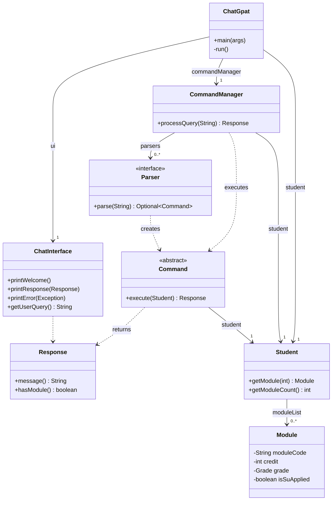
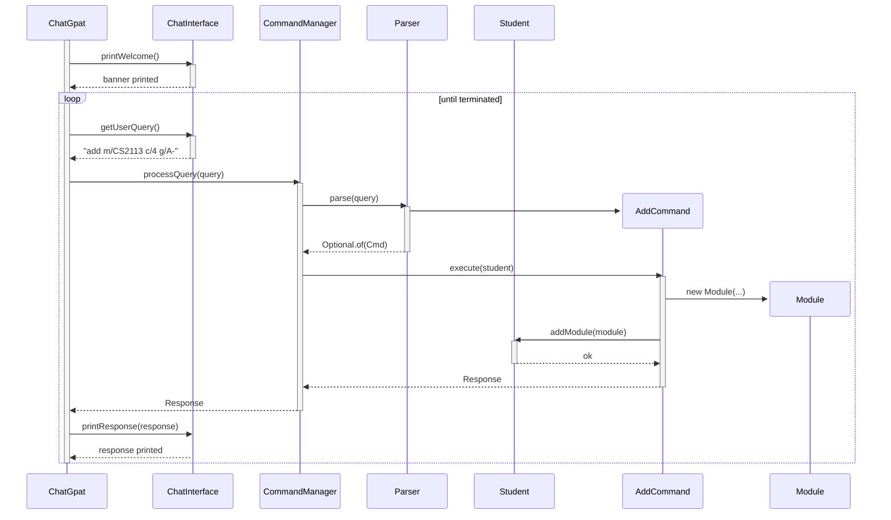
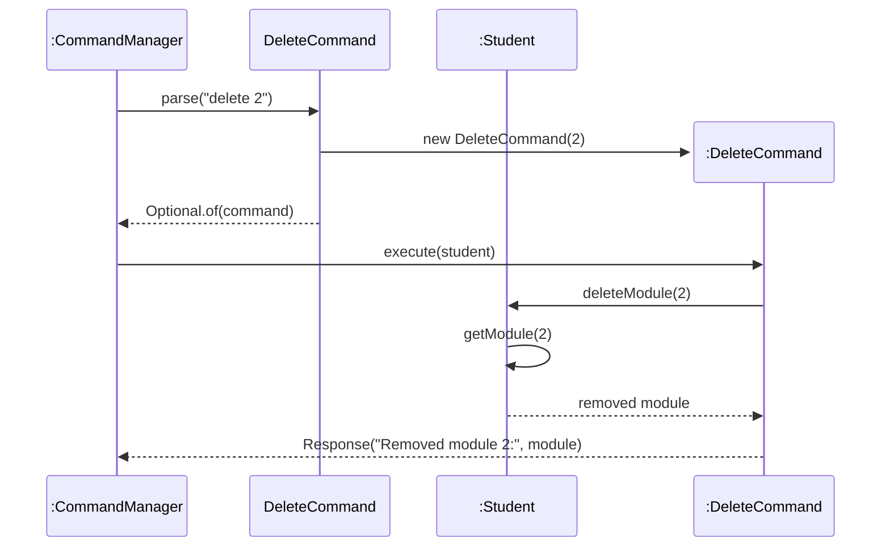
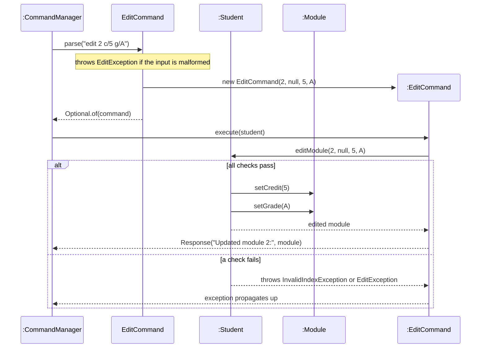
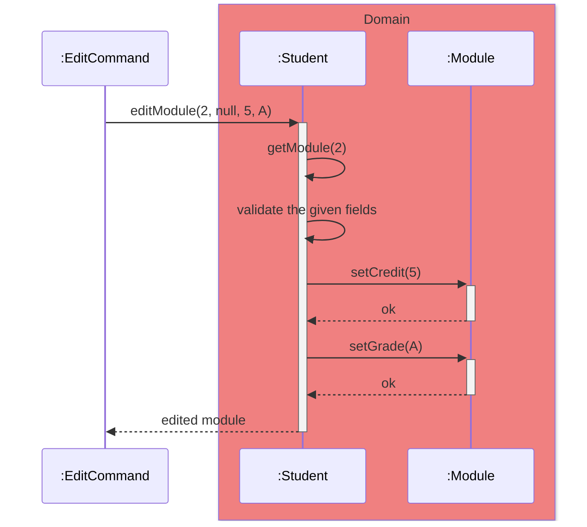
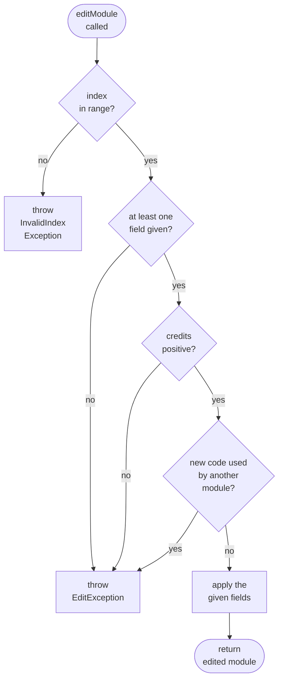
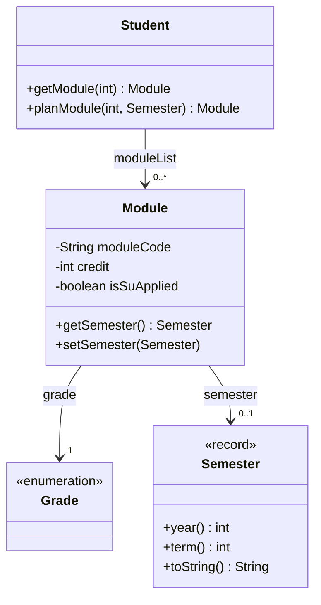
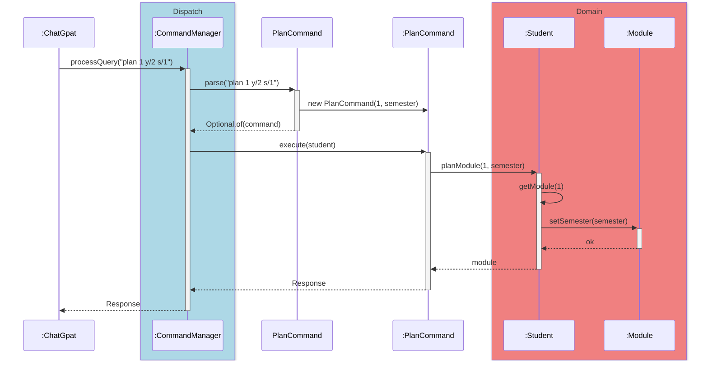
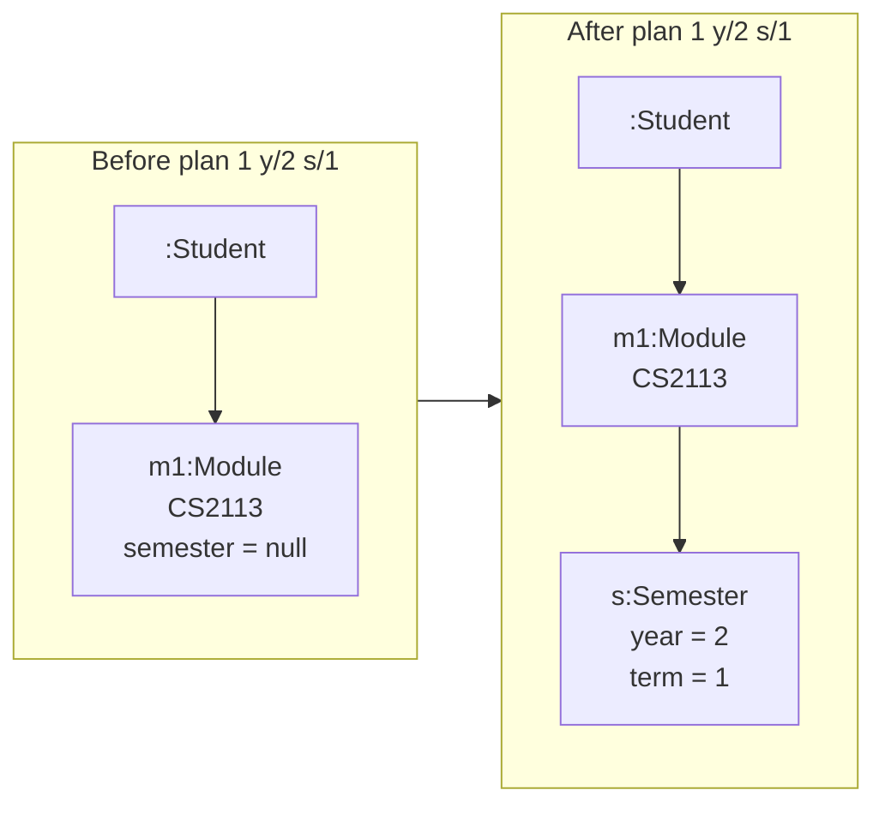
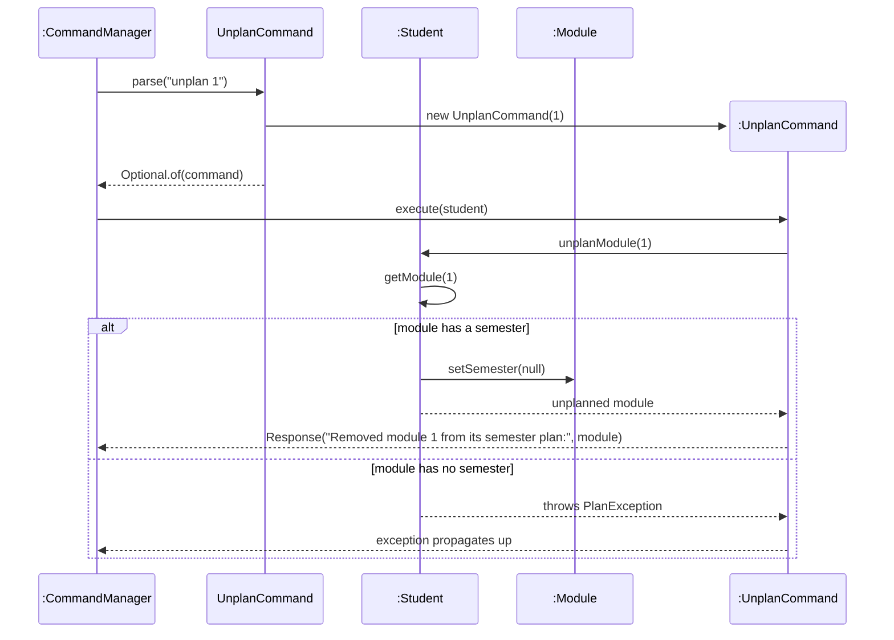

# Developer Guide

## Acknowledgements

* ChatGpat is developed on the SE-EDU `duke` project template.
* Diagrams are written in [Mermaid](https://mermaid.js.org/) and rendered directly on GitHub.

## Design

### Architecture

The skeleton follows a layered design:

- **Entry point**: `ChatGpat` constructs the components and runs the main loop.
- **Presentation**: `ChatInterface` reads user input and prints responses.
- **Dispatch**: `CommandManager` parses user input into a `Command` and executes it.
- **Domain**: `Student` owns the module list; `Module` represents a single record.
- **Persistence**: `Storage` reads and writes local text records and returns diagnostics without printing.
- **Cross-cutting**: `Command` (abstract), `Response`, `Parser`, and the custom exceptions.

The diagram below shows the classes and their dependencies in the skeleton.

The concrete `*Command` subclasses are omitted here. `Parser<Command>` is a functional interface, so each command provides a `parse` method reference that becomes one `Parser` in `CommandManager`.

**How the components interact.** When the user types a command, `ChatGpat` passes it to `CommandManager.processQuery`. `CommandManager` asks each `Parser` in turn; the first one that returns a `Command` wins. The command is executed with the `Student` object, and the returned `Response` is printed by `ChatInterface`. The loop repeats until the process is terminated.

The sequence diagram below shows one full iteration of the loop for `add m/CS2113 c/4 g/A-`.

### UI component

### Logic component

### Model component

### Storage component

### Common classes

---

## Implementation

This section describes noteworthy details on how certain features are implemented.

### Index-based module commands

`delete`, `edit`, `plan` and `unplan` all act on one module, chosen by its position in the list shown by `list` (`INDEX`, starting from 1). They share the same flow:

1. `CommandManager` asks each `Parser<Command>` in turn. The `parse` method of the matching command checks the input with regular expressions and returns a `Command`, or an empty `Optional` if the input is not meant for it.
2. `Command#execute(Student)` asks `Student` to change the data, then returns a `Response`. By design, commands do not print: `ChatInterface` prints every `Response`.
3. `Student` looks the module up with `Student#getModule(int)`, which throws `InvalidIndexException` when the index is out of range. Expected errors such as this are `ChatGpatException`s: `ChatGpat#run` catches them and prints the message as a normal response. Any other unexpected exception is caught by a second `catch` block, which prints a generic error and logs the details. Either way the program keeps running, and the commands above validate their input before changing any data.

### Delete feature

#### Implementation

The delete feature is facilitated by `DeleteCommand` (a subclass of `Command`) and `Student#deleteModule(int)`.

* `DeleteCommand#parse(String)` — matches `delete\s+(\d+)` and returns a `DeleteCommand` holding the index, or `Optional.empty()` so that the next parser is tried.
* `Student#deleteModule(int)` — looks the module up with `getModule`, removes it from `moduleList`, and returns the removed module.
* `DeleteCommand#execute(Student)` — calls `deleteModule` and returns a `Response` containing the message and the removed module, so `ChatInterface` can show what was deleted.

Given below is an example usage scenario.

Step 1. The user has three modules recorded and runs `list` to see their numbers.

Step 2. The user executes `delete 2`. `CommandManager` tries each parser until `DeleteCommand#parse` returns a `DeleteCommand` for index 2.

Step 3. `CommandManager` calls `execute(student)` on it. `Student#deleteModule(2)` removes the second module and returns it, and the command returns the response `Removed module 2:` with the deleted module.

The following sequence diagram shows how the `delete 2` command is processed.

**Note:** If the index is out of range, `deleteModule` throws `InvalidIndexException` before anything is removed, so no data changes. Because the modules after the deleted one move up by one, the user should run `list` again before using another index.

#### Design considerations

**Aspect: How the user picks the module to delete**

* **Alternative 1 (current choice):** By the `INDEX` shown in `list`.
    * Pros: Short to type, and the same for `edit`, `su`, `unsu`, `plan` and `unplan`.
    * Cons: Indexes shift after a delete, so the user must `list` again.
* **Alternative 2:** By module code.
    * Pros: Stable even after other modules are removed.
    * Cons: Longer to type, and typos or letter-case differences need extra handling.

**Aspect: Who reports the result**

* **Alternative 1 (current choice):** `Student` returns the removed module and `DeleteCommand` builds the `Response`.
    * Pros: The output goes through `ChatInterface` only, and `Student` can be tested without capturing console output.
    * Cons: Slightly more code in each command.
* **Alternative 2:** `Student` prints the result itself.
    * Pros: Less code.
    * Cons: Output handling is spread across classes, which is harder to test and breaks the layering.

### Edit feature

#### Implementation

The edit feature is facilitated by `EditCommand`, `Student#editModule(int, String, Integer, Grade)` and the setters in `Module`.

* `EditCommand#parse(String)` — claims the input if it is `edit` or starts with `edit ` (so that a malformed edit gets a helpful message instead of "Unknown command"). It then matches `edit\s+(\d+)` followed by any number of `m/`, `c/` and `g/` fields, converts the credits to a number and the grade to a `Grade`, and builds an `EditCommand`. A field the user did not give is `null`, meaning "keep the current value". A malformed command, a non-numeric credit or an unknown grade throws `EditException`.
* `Student#editModule(...)` — validates everything first, then applies the given fields through `Module#setModuleCode`, `setCredit` and `setGrade`, and returns the edited module.
* `EditCommand#execute(Student)` — calls `editModule` and returns a `Response` with the message and the updated module.

Given below is an example usage scenario.

Step 1. The user runs `list` and sees `2. MA1521 | 4 MCs | Grade: B+`.

Step 2. The user executes `edit 2 c/5 g/A`. `EditCommand#parse` builds a command with index 2, no new code, credits 5 and grade A.

Step 3. `execute` calls `Student#editModule(2, null, 5, A)`. All checks pass, so only the credits and grade are changed. The response shows `MA1521 | 5 MCs | Grade: A`.

The following sequence diagram shows how the `edit 2 c/5 g/A` command is processed.

Similarly, how `Student#editModule` works inside the `Domain` layer is shown below.

The following activity diagram shows the checks that `editModule` makes before it changes anything.

**Note:** All checks happen before any setter is called, so a rejected edit never leaves a module half-edited.

#### Design considerations

**Aspect: How the fields are updated**

* **Alternative 1 (current choice):** Change the existing `Module` through setters, with `null` meaning "keep the current value".
    * Pros: Other data on the module, such as the S/U flag and the semester, is kept automatically, and one command handles any combination of fields.
    * Cons: `Module` becomes mutable, and the meaning of `null` must be documented.
* **Alternative 2:** Create a new `Module` with the changed fields and replace the old one.
    * Pros: `Module` can stay immutable.
    * Cons: Every field must be copied across, so a new field such as the semester is easy to lose.

**Aspect: When the input is validated**

* **Alternative 1 (current choice):** Validate every field first, then apply them.
    * Pros: A failed edit never leaves a half-edited module.
    * Cons: The checks are separated from the code that applies each field.
* **Alternative 2:** Validate and apply each field one at a time.
    * Pros: Each field's check sits next to its update.
    * Cons: A later failure can leave earlier fields already changed.

### [Proposed] Plan feature

#### Proposed Implementation

The proposed plan feature lets the user place a module in a year and semester. It is facilitated by the new `Semester` record, a new optional `semester` field in `Module`, `Student#planModule(int, Semester)` and `PlanCommand`.

* `Semester` — an immutable record of a year (1 to 4) and a semester number (1 or 2). Its constructor throws `PlanException` for out-of-range values, so an invalid `Semester` cannot exist. `toString` gives the form `Y2S1`.
* `Module#semester` — `null` means the module is not planned yet. `Module#toString` appends ` | Y2S1` only when it is set, so planned modules show their semester in `list`, `add`, `edit` and `su` without any change to those commands.
* `PlanCommand#parse(String)` — claims the input if it is `plan` or starts with `plan `. It matches `plan INDEX y/YEAR s/SEM`, converts the numbers (reporting non-numbers as a `PlanException`), and builds the `Semester`. A malformed command throws a `PlanException` with the usage message.
* `Student#planModule(int, Semester)` — gets the module with `getModule` and sets its semester. If the module is already planned, it is simply moved to the new semester.

Given below is an example usage scenario.

Step 1. The user has added `CS2113`, which is module 1 and is not planned.

Step 2. The user executes `plan 1 y/2 s/1`. `PlanCommand#parse` creates `Semester(2, 1)`, then a `PlanCommand` for index 1.

Step 3. `execute` calls `Student#planModule(1, semester)`, which sets the module's semester. The response is `Planned module 1 for Y2S1:` followed by the module line, which now ends in `| Y2S1`.

The following sequence diagram shows how the `plan 1 y/2 s/1` command goes through the `Dispatch` and `Domain` layers when it succeeds.

**Note:** The `Semester` object is created inside `PlanCommand#parse` and is not shown, to keep the diagram simple. If the index is out of range, `getModule` throws `InvalidIndexException`. If the year or semester is invalid, the `Semester` constructor throws `PlanException`. In both cases nothing is changed.

The following object diagram shows the effect of `plan 1 y/2 s/1` on the first module.

#### Design considerations

**Aspect: How a semester is represented**

* **Alternative 1 (current choice):** A separate `Semester` record that validates itself.
    * Pros: An invalid year or semester cannot exist, `equals` comes for free (useful for later filtering and summaries), and the `Y2S1` format is defined in one place.
    * Cons: One more class.
* **Alternative 2:** Two plain `int` fields on `Module`.
    * Pros: No new class.
    * Cons: Validation and formatting are repeated wherever they are used, and the year can be set without the semester.

**Aspect: Representing "not planned"**

* **Alternative 1 (current choice):** A `null` semester.
    * Pros: Simple, existing modules and tests are unaffected, and saved data from before the feature can be loaded as unplanned.
    * Cons: Callers must check for `null`.
* **Alternative 2:** `Optional<Semester>` or a special "unplanned" constant.
    * Pros: Makes the unplanned case explicit.
    * Cons: More code, and `Optional` is generally discouraged as a field type.

**Aspect: Where the command lives**

* **Alternative 1 (current choice):** A separate `plan` command.
    * Pros: `edit` stays unchanged and the semester is set in one place.
    * Cons: One more command to learn.
* **Alternative 2:** Add optional `y/` and `s/` fields to `edit`.
    * Pros: Fewer commands.
    * Cons: `edit`'s validation gets more tangled, and the year and semester only make sense together.

### Unplan feature

#### Implementation

The unplan feature removes a module's semester again. It is implemented by `UnplanCommand` and `Student#unplanModule(int)`, and reuses `Module#setSemester`.

* `UnplanCommand#parse(String)` — matches `unplan\s+(\d+)` and returns an `UnplanCommand`. It does not clash with `PlanCommand`, because that parser only claims input that is `plan` or starts with `plan `.
* `Student#unplanModule(int)` — gets the module with `getModule`. If its semester is `null`, it throws a `PlanException` saying the module is not planned. Otherwise it calls `setSemester(null)` and returns the module.
* `UnplanCommand#execute(Student)` — returns `Response.forDataChange` with the message and module, requesting an automatic save.

The following sequence diagram shows how `unplan 1` is processed.

**Note:** If the index is out of range, `getModule` throws `InvalidIndexException`, and nothing is changed.

#### Design considerations

**Aspect: Unplanning a module that has no semester**

* **Alternative 1 (current choice):** Report an error.
    * Pros: The user learns that the command had no effect, which usually means a wrong index.
    * Cons: The command is not idempotent.
* **Alternative 2:** Succeed silently.
    * Pros: Safe to repeat.
    * Cons: A mistaken index goes unnoticed.

**Aspect: How the user clears a semester**

* **Alternative 1 (current choice):** A separate `unplan` command, paired with `plan` like `su` and `unsu`.
    * Pros: Consistent with the existing command pairs, and easy to remember.
    * Cons: One more command.
* **Alternative 2:** A special value such as `plan INDEX y/0 s/0`.
    * Pros: No new command.
    * Cons: An unclear special case that makes `Semester` validation harder.

### Local storage

`Storage` owns the UTF-8 file at `data/modules.txt`, relative to the process working directory. Its constructor also accepts a `Path` so tests can use JUnit's `@TempDir`. No file is created by loading a missing path.

The file format has no header and stores one module per physical line. These positions are the persistence contract for future features:

| Position | Field | Validation / default |
| --- | --- | --- |
| 1 | Module code | Required, non-empty, no whitespace; case-insensitive uniqueness |
| 2 | MCs | Required positive Java `int` |
| 3 | Original grade | Required `Grade` label, including `CS` and `CU` |
| 4 | S/U flag | `0` or `1`; omitted/empty defaults to `0` |
| 5 | Semester | `Y1S1` through `Y4S2`, or `-`; omitted/empty is unplanned |
| 6 | Module name | Omitted/empty defaults to the code |
| 7 | Module description | Omitted/empty defaults to an empty string |

Fields are separated by unescaped `|`, with optional surrounding spaces. The writer emits all seven fields. The reader accepts three to seven fields, ignores blank lines, and tolerates a UTF-8 byte order mark. Names and descriptions are saved even though `add` currently supplies the code as the name and an empty description.

Escapes are `\|`, `\\`, `\n`, `\r`, `\t`, and `\s` (literal space). The reader trims separator padding before decoding. The writer escapes boundary spaces so they survive a round trip. Unknown or incomplete escapes invalidate only that line. Extra fields currently invalidate a line, helping catch accidental unescaped pipes.

**Extending the format:** Append new optional fields; do not reorder or reuse these positions. Update `Storage`'s parser, writer and field-count limit together, give each added field a default for shorter records, update this table, and add a round-trip test. Backward compatibility means new releases read old records; it does not promise that old releases read new fields.

**Startup:** `ChatGpat.run` calls `Storage.load()`, adds the returned modules to the student, then passes `LoadResult.warnings()` to `ChatInterface.printWelcome`. Validation and duplicate detection happen per line, so a bad record cannot stop later records loading. Read errors return warnings. Storage neither prints nor logs to the console.

**Commands:** Successful mutating commands return `Response.forDataChange(message, module)`. `ChatGpat` checks `isDataChanged()`, saves `student.getModules()`, and passes any save error to `ChatInterface` alongside the command response. Viewing commands use the ordinary response constructors; failed commands throw before returning a save request. Future commands that modify persisted data must use `forDataChange` too.

**Saving:** The writer creates parent directories as needed, writes a sibling temporary file, then replaces the destination atomically where supported (falling back to a normal replacement where atomic moves are unavailable). This avoids truncating the existing file during serialization or writing. I/O and access errors return a message instead of escaping the command loop. Temporary-file cleanup is attempted on success and failure. The in-memory state is retained after a save failure; the next successful mutating command retries the full list.

**Verification:** `StorageTest` covers a real save/load round trip, escaped text, legacy defaults, malformed lines and duplicates, missing/unreadable files, and failed saves. `ChatGpatTest` verifies that each of the seven mutating commands saves before its response, sessions restore saved state, viewing/rejected commands do not rewrite the file, and save errors reach the UI while commands continue working.

## Product scope
### Target user profile

{Describe the target user profile}

### Value proposition

{Describe the value proposition: what problem does it solve?}

## User Stories

|Version| As a ... | I want to ... | So that I can ...|
|--------|----------|---------------|------------------|
|v1.0|new user|see usage instructions|refer to them when I forget how to use the application|
|v2.0|user|find a to-do item by name|locate a to-do without having to go through the entire list|

## Non-Functional Requirements

{Give non-functional requirements}

## Glossary

* *glossary item* - Definition

## Instructions for manual testing

{Give instructions on how to do a manual product testing e.g., how to load sample data to be used for testing}
