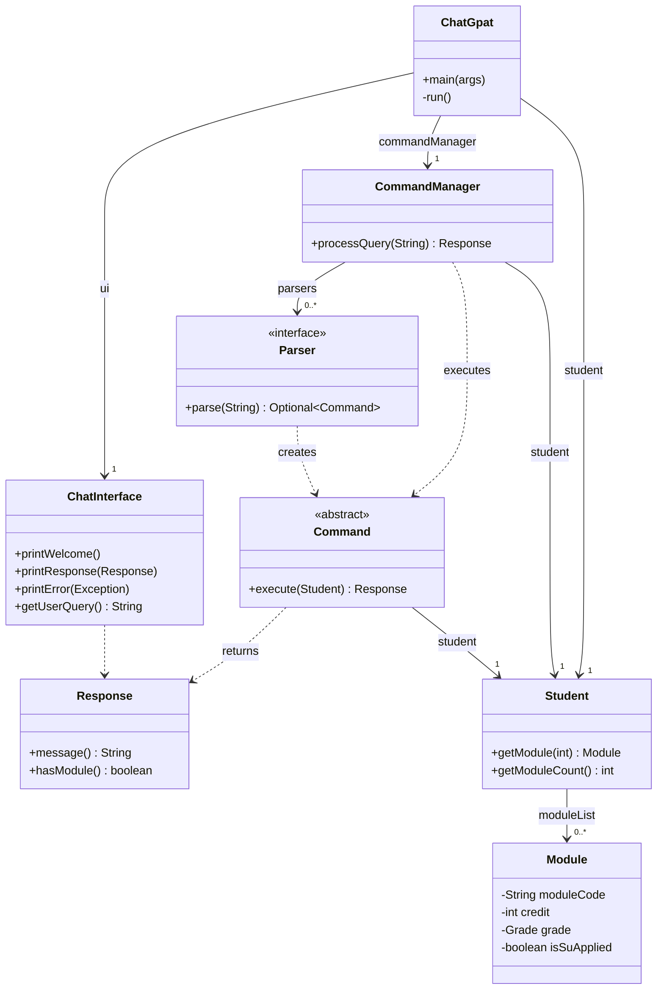
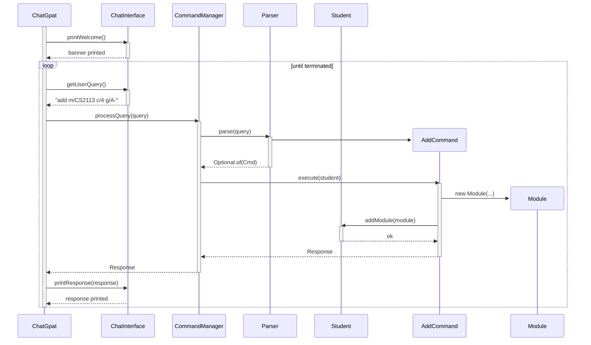

# Developer Guide

## Acknowledgements

* ChatGpat is developed on the SE-EDU `duke` project template.
* Diagrams are written in [Mermaid](https://mermaid.js.org/) and rendered directly on GitHub.

## Design

### Architecture

The skeleton follows a layered design:

- **Entry point**: `ChatGpat` constructs the components and runs the main loop.
- **Presentation**: `ChatInterface` reads user input and prints responses.
- **Dispatch**: `CommandManager` parses user input into a `Command` and executes it.
- **Domain**: `Student` owns the module list; `Module` represents a single record.
- **Cross-cutting**: `Command` (abstract), `Response`, `Parser`, and the custom exceptions.

The diagram below shows the classes and their dependencies in the skeleton.

The concrete `*Command` subclasses are omitted here. `Parser<Command>` is a functional interface, so each command provides a `parse` method reference that becomes one `Parser` in `CommandManager`.

**How the components interact.** When the user types a command, `ChatGpat` passes it to `CommandManager.processQuery`. `CommandManager` asks each `Parser` in turn; the first one that returns a `Command` wins. The command is executed with the `Student` object, and the returned `Response` is printed by `ChatInterface`. The loop repeats until the process is terminated.

The sequence diagram below shows one full iteration of the loop for `add m/CS2113 c/4 g/A-`.

### UI component

### Logic component

### Model component

### Storage component

### Common classes

---

## Implementation

This section describes the two parts of the skeleton that a new command must interact with: the main loop and the dispatch pipeline. The goal is to make clear what a developer must know before adding the next command.

## Product scope
### Target user profile

{Describe the target user profile}

### Value proposition

{Describe the value proposition: what problem does it solve?}

## User Stories

|Version| As a ... | I want to ... | So that I can ...|
|--------|----------|---------------|------------------|
|v1.0|new user|see usage instructions|refer to them when I forget how to use the application|
|v2.0|user|find a to-do item by name|locate a to-do without having to go through the entire list|

## Non-Functional Requirements

{Give non-functional requirements}

## Glossary

* *glossary item* - Definition

## Instructions for manual testing

{Give instructions on how to do a manual product testing e.g., how to load sample data to be used for testing}
