# Developer Guide

## Acknowledgements

* ChatGpat is developed on the SE-EDU `duke` project template.
* The structure of this guide follows the [AddressBook-Level3 Developer Guide](https://se-education.org/addressbook-level3/DeveloperGuide.html).
* Diagrams are drawn with [PlantUML](https://plantuml.com/) and exported as images, so that they also show on the GitHub Pages site.

## Design

> **Tip:** The `.puml` files used to create the diagrams in this document are in the `docs/diagrams` folder. To update a diagram, edit its `.puml` file, export it as a PNG into `docs/images`, and commit both files.

### Architecture

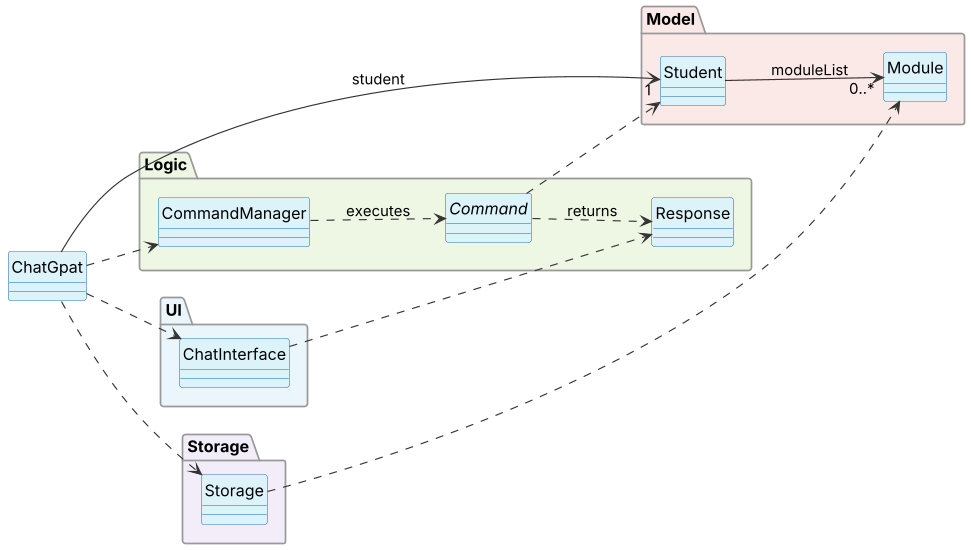

The *Architecture Diagram* given above explains the high-level design of ChatGpat. Given below is a quick overview of its main components and how they interact with each other.

**Main components of the architecture**

`ChatGpat` is the entry point. It constructs the other components when the app starts and runs the main loop: read a line, hand it over for execution, and print the result.

The rest of the app is made up of four components:

* **UI** (`ChatInterface`): reads the user's input and prints every response. It is the only class that prints, so commands never print themselves.
* **Logic** (`CommandManager`, `Parser`, `Command`, `Response`): turns a line of text into a `Command` and executes it. In the diagrams of the individual features, this is the *Dispatch* layer.
* **Model** (`Student`, `Module`): holds the module records in memory. In the diagrams of the individual features, this is the *Domain* layer.
* **Storage** (`Storage`): reads and writes local text records and returns diagnostics without printing.

A set of **common classes**, mainly the custom exceptions, is used by several components.

**How the architecture components interact with each other**

The *Sequence Diagram* below shows one full iteration of the main loop, for the input `add m/CS2113 c/4 g/A-`.

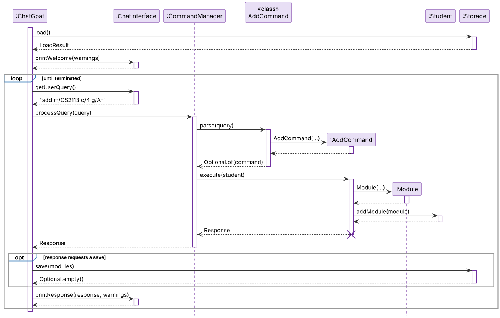

When the user types a command, `ChatGpat` passes it to `CommandManager#processQuery`. `CommandManager` asks each `Parser` in turn, and the first one that returns a `Command` wins. The diagram shows only the parser of `AddCommand`, because the parsers tried before it return an empty `Optional` for this input. The command is executed with the `Student` object, and the returned `Response` is printed by `ChatInterface`. The loop repeats until the user exits.

If something goes wrong, the code throws an exception that is a subclass of `ChatGpatException`. `ChatGpat#run` catches it and prints its message as a normal response. Any other unexpected exception is caught by a second `catch` block, which prints a generic error and logs the details. Either way, the loop continues.

The sections below give more details of each component.

### UI component

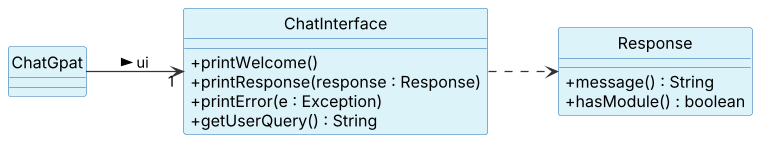

The UI component consists of the class `ChatInterface`.

It does the following:

* prints the welcome message (`printWelcome`), responses (`printResponse`) and error messages (`printError`)
* reads one line of input from the user (`getUserQuery`)
* shows the message of a `Response` and, if the response contains a module (`hasModule`), that module as well, so that the user can see what a command changed

`ChatInterface` does not know how a command works. It depends only on `Response`, which is what the Logic component returns. All other components return values or throw exceptions instead of printing.

### Logic component

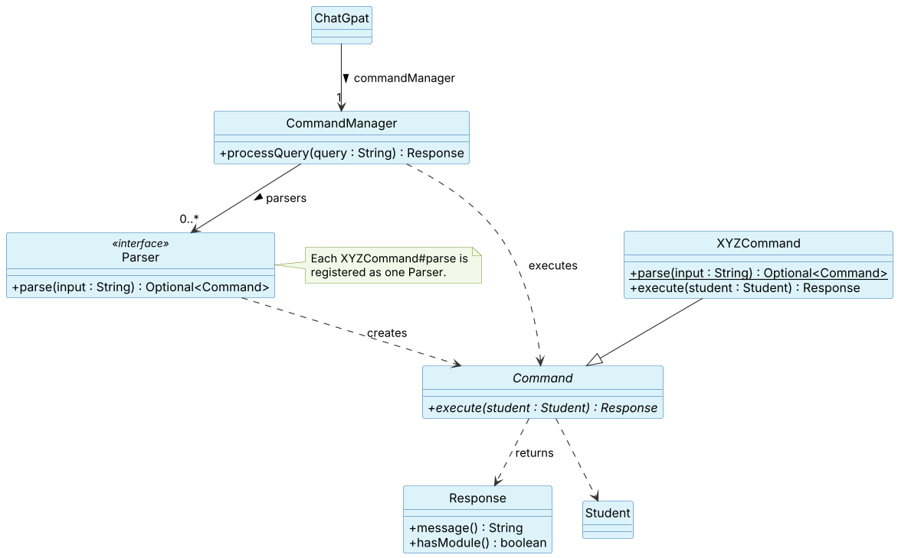

The Logic component turns the user's input into a change in the Model. Here is how it works:

1. `ChatGpat` calls `CommandManager#processQuery` with the line that the user typed.
2. `CommandManager` holds a list of `Parser<Command>` objects. Each command class (shown as `XYZCommand` in the diagram, standing for `AddCommand`, `DeleteCommand` and so on) provides a static `parse` method, and each of these methods is registered as one `Parser`.
3. `CommandManager` tries the parsers in order and uses the first one that returns a `Command`. If none does, it throws `UnknownCommandException`.
4. A parser returns an empty `Optional` if the input is not meant for it. A command that claims a keyword (`edit`, `plan` and `unplan`) instead throws its own exception with a usage message when the arguments are malformed, so that the user does not see a misleading "unknown command".
5. `CommandManager` calls `Command#execute(Student)`. The command asks `Student` to make the change and returns a `Response` that holds a message and, optionally, a module.

`Command` is abstract, and `Response` is a plain value object. Neither of them prints anything.

### Model component

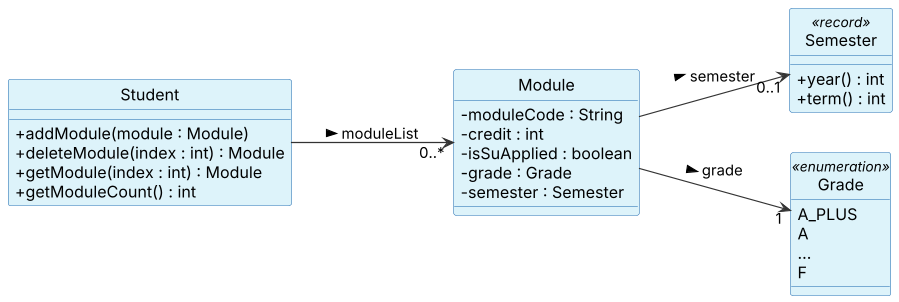

The Model component consists of `Student`, `Module`, `Grade` and `Semester`. It:

* stores all recorded modules in the list `moduleList` of `Student`
* identifies a module to the outside by its position in that list, counting from 1 (the `INDEX` used by commands such as `edit` and `delete`)
* stores the details of a module in `Module`: its code, credits, `Grade` (an enumeration), whether S/U is applied, and an optional `Semester`
* treats a `null` semester as "not planned yet". `Semester` is an immutable record of a year (1 to 4) and a semester number (1 or 2), and it throws `PlanException` for out-of-range values
* validates its input before changing anything. When something is wrong, `Student` throws a subclass of `ChatGpatException` (for example `InvalidIndexException` or `DuplicateModuleException`) and leaves the data unchanged
* does not depend on any other component, and does not print

The diagram omits the other query and update methods of `Student` and some descriptive fields of `Module`.

### Storage component

The Storage component (`Storage`) reads and writes the module records as local text. It returns diagnostics, such as a line it could not read, to its caller instead of printing them, so that `ChatInterface` remains the only class that prints. The details of the file format and the loading and saving flow are in the *Local storage* section under *Implementation*.

### Common classes

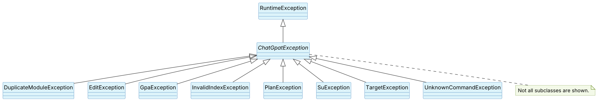

The classes in this section are used by more than one component. They are the exceptions of ChatGpat.

`ChatGpatException` is an abstract, unchecked exception. Every error that the user can cause has its own subclass, for example `InvalidIndexException`, `EditException` or `PlanException`, which carries a message that is meant to be shown to the user. `ChatGpat#run` catches `ChatGpatException` and prints the message, so a bad command never ends the program.

---

## Implementation

This section describes noteworthy details on how certain features are implemented.

### Help feature

#### Implementation

`HelpCommand` returns the command reference in a `Response`, leaving the application running without saving. Its parser accepts `help` with optional whitespace-separated arguments but rejects words such as `helpful`. Unknown-command errors direct users to `help`.

#### Design considerations

The help text is stored in `HelpCommand` and printed by `ChatInterface`. Update it when registering new commands in `CommandManager`.

**Verification:** `CommandManagerTest` checks help text, extra arguments, invalid keywords and the non-exit response.

### Add Module feature

#### Implementation

The add feature stores a new module in the student's record. The domain-side implementation is provided by `Module` and `Student#addModule(Module)`; command parsing is handled by `AddCommand` as shown in the architecture diagrams.

* `AddCommand` — interprets the user's module details and creates a `Module` before passing it to `Student`. The existing architecture illustrates `add m/CS2113 c/4 g/A-`; the uploaded files do not include `AddCommand`, so its complete parsing and validation rules cannot be confirmed here.
* `Module` — holds the module code, name, description, modular credits, grade and S/U status. `Grade#fromLabel(String)` converts a grade label (such as `A-`) to the corresponding `Grade` enum and rejects unknown labels.
* `Student#addModule(Module)` — checks for an existing module with the same code, ignoring letter case, using `isModuleExists`. If a duplicate exists, it logs a warning and throws `DuplicateModuleException`; otherwise, it appends the module to `moduleList`.

Given below is an example usage scenario.

Step 1. The user enters `add m/CS2113 c/4 g/A-` (as illustrated in the architecture section).

Step 2. The add command constructs a `Module` from the parsed details and invokes `Student#addModule(module)`.

Step 3. `Student` checks the module code for duplicates and adds the module to the list if none exists. The command then returns a `Response` for display by `ChatInterface`.

TThe following sequence diagram illustrates how the
Add Module feature is executed.

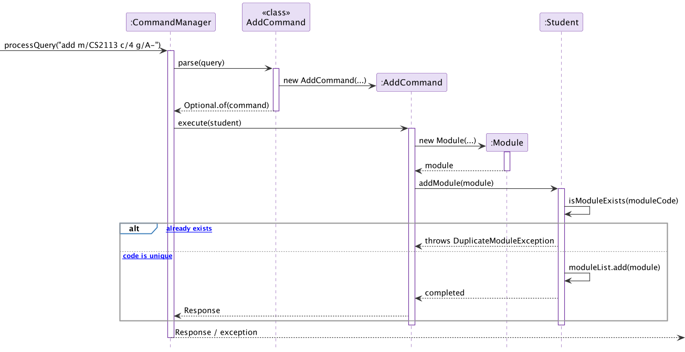

**Note:** Duplicate checking is case-insensitive. The `Module` constructor preserves the supplied `isSuApplied` value so saved S/U status can be restored. The command's exact syntax beyond the architecture example should be checked against `AddCommand.java`.

### List All Modules feature

#### Implementation

The list feature displays the student's recorded modules in insertion order through `ListCommand` and `Module#toString()`. The former `Student#printModuleList()` method has been removed.

* `ListCommand#execute(Student)` — returns a `Response` containing `No modules recorded yet.` if the list is empty, or a heading and module entries numbered from 1. `ChatInterface` prints the response.
* `Module#toString()` — formats each entry as `MODULE_CODE | CREDIT MCs | Grade: GRADE`, with ` [S/U]` appended if S/U has been applied.
* `Student#getModuleCount()` and `Student#getModule(int)` — provide the count and 1-based indexed access for other commands. `getModule` throws `InvalidIndexException` for an invalid index.

Given below is an example usage scenario.

Step 1. The student has added `CS2113` (4 MCs, A-) and `MA1521` (4 MCs, B+).

Step 2. The user enters `list`. The command dispatch layer selects `ListCommand`.

Step 3. The displayed list is:

```text
Here are your recorded modules:
1. CS2113 | 4 MCs | Grade: A-
2. MA1521 | 4 MCs | Grade: B+
```

The following sequence diagram illustrates the existing `Student#printModuleList()` method. The command-to-UI integration cannot be verified without the list command source.

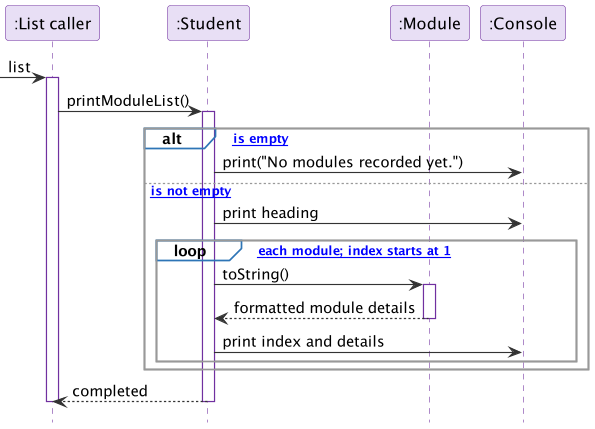

**Note:** Unlike the general architecture's response-based output design, the uploaded `printModuleList()` prints directly to `System.out`. If the actual list command uses `Response` instead, its implementation should be documented after inspecting that command.

#### Design considerations

**Aspect: How list output is produced**

* **Alternative 1:** Have `Student` print the records directly.
  * Pros: Simple implementation with straightforward numbering and formatting.
  * Cons: Couples domain logic to console output and makes output testing harder.
* **Alternative 2 (current choice):** A list command builds a `Response` and delegates printing to `ChatInterface`.
  * Pros: Consistent with the layered architecture and easier to test without capturing console output.
  * Cons: Requires the command or response model to carry the formatted list.

### Index-based module commands

`delete`, `edit`, `plan` and `unplan` all act on one module, chosen by its position in the list shown by `list` (`INDEX`, starting from 1). They share the same flow:

1. `CommandManager` asks each `Parser<Command>` in turn. The `parse` method of the matching command checks the input with regular expressions and returns a `Command`, or an empty `Optional` if the input is not meant for it.
2. `Command#execute(Student)` asks `Student` to change the data, then returns a `Response`. By design, commands do not print: `ChatInterface` prints every `Response`.
3. `Student` looks the module up with `Student#getModule(int)`, which throws `InvalidIndexException` when the index is out of range. Expected errors such as this are `ChatGpatException`s: `ChatGpat#run` catches them and prints the message as a normal response. Any other unexpected exception is caught by a second `catch` block, which prints a generic error and logs the details. Either way the program keeps running, and the commands above validate their input before changing any data.

The sequence diagrams below follow the UML notation used in the course: `:Name` is an object, `<<class>>` marks a class on which a class-level (static) method such as `parse` is called, and a dashed arrow is a return.

### Delete feature

#### Implementation

The delete feature is facilitated by `DeleteCommand` (a subclass of `Command`) and `Student#deleteModule(int)`.

* `DeleteCommand#parse(String)` — matches `delete\s+(\d+)` and returns a `DeleteCommand` holding the index, or `Optional.empty()` so that the next parser is tried.
* `Student#deleteModule(int)` — looks the module up with `getModule`, removes it from `moduleList`, and returns the removed module.
* `DeleteCommand#execute(Student)` — calls `deleteModule` and returns a `Response` containing the message and the removed module, so `ChatInterface` can show what was deleted.

Given below is an example usage scenario.

Step 1. The user has three modules recorded and runs `list` to see their numbers.

Step 2. The user executes `delete 2`. `CommandManager` tries each parser until `DeleteCommand#parse` returns a `DeleteCommand` for index 2.

Step 3. `CommandManager` calls `execute(student)` on it. `Student#deleteModule(2)` removes the second module and returns it, and the command returns the response `Removed module 2:` with the deleted module.

The following sequence diagram shows how the `delete 2` command is processed.

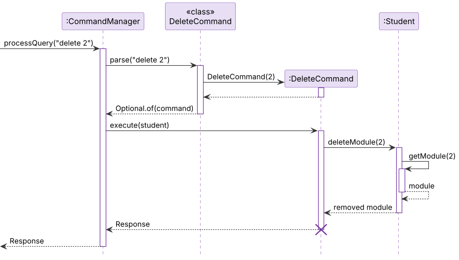

**Note:** If the index is out of range, `deleteModule` throws `InvalidIndexException` before anything is removed, so no data changes. Because the modules after the deleted one move up by one, the user should run `list` again before using another index.

#### Design considerations

**Aspect: How the user picks the module to delete**

* **Alternative 1 (current choice):** By the `INDEX` shown in `list`.
  * Pros: Short to type, and the same for `edit`, `su`, `unsu`, `plan` and `unplan`.
  * Cons: Indexes shift after a delete, so the user must `list` again.
* **Alternative 2:** By module code.
  * Pros: Stable even after other modules are removed.
  * Cons: Longer to type, and typos or letter-case differences need extra handling.

**Aspect: Who reports the result**

* **Alternative 1 (current choice):** `Student` returns the removed module and `DeleteCommand` builds the `Response`.
  * Pros: Only `ChatInterface` prints, and `Student` can be tested without capturing console output.
  * Cons: Slightly more code in each command.
* **Alternative 2:** `Student` prints the result itself.
  * Pros: Less code.
  * Cons: Output handling is spread across classes, which is harder to test and breaks the layering.

### Edit feature

#### Implementation

The edit feature is facilitated by `EditCommand`, `Student#editModule(int, String, Integer, Grade)` and the setters in `Module`.

* `EditCommand#parse(String)` — claims any input that starts with `edit`. It then matches `edit\s+(\d+)` followed by any number of `m/`, `c/` and `g/` fields, reads each field, and builds an `EditCommand`. A field the user did not give is `null`, meaning "keep the current value". If the input starts with `edit` but is malformed, it throws `EditException` with the usage message instead of returning empty, because otherwise the user would see the misleading "Unknown command".
* `Student#editModule(...)` — validates everything first, then applies the given fields through `Module#setModuleCode`, `setCredit` and `setGrade`, and returns the edited module.
* `EditCommand#execute(Student)` — calls `editModule` and returns a `Response` with the message and the updated module.

Given below is an example usage scenario.

Step 1. The user runs `list` and sees that module 2 is `MA1521`, worth 4 MCs, with grade B+.

Step 2. The user executes `edit 2 c/5 g/A`. `EditCommand#parse` builds a command with index 2, no new code, credits 5 and grade A.

Step 3. `execute` calls `Student#editModule(2, null, 5, A)`. All checks pass, so only the credits and grade are changed. The response shows `MA1521` with 5 MCs and grade A.

The following sequence diagram shows how the `edit 2 c/5 g/A` command is processed.

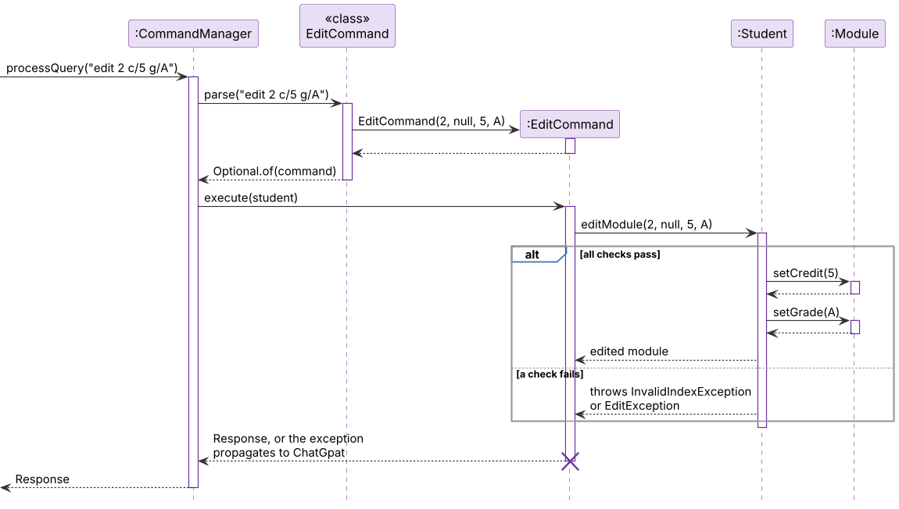

The following sequence diagram shows what happens inside the `Domain` layer when `Student#editModule` runs successfully.

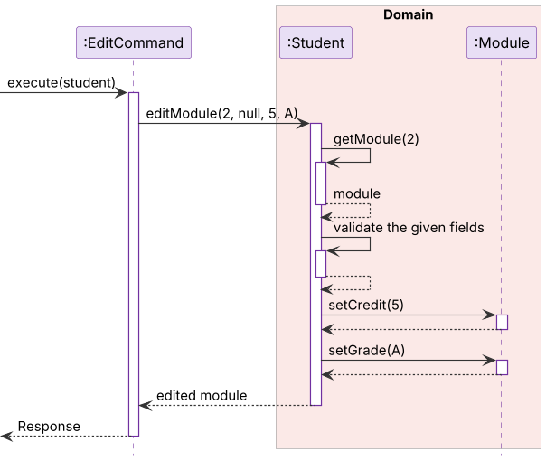

The following activity diagram shows the checks that `editModule` makes before it changes anything.

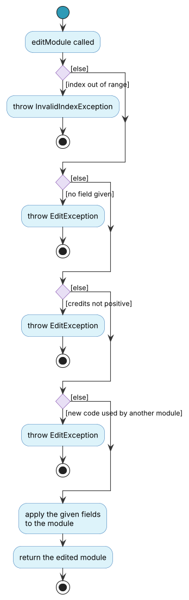

**Note:** All checks happen before any setter is called, so a rejected edit never leaves a module half-edited.

#### Design considerations

**Aspect: How the fields are updated**

* **Alternative 1 (current choice):** Change the existing `Module` through setters, with `null` meaning "keep the current value".
  * Pros: Other data on the module, such as the S/U flag and the semester, is kept automatically, and one command handles any combination of fields.
  * Cons: `Module` becomes mutable, and the meaning of `null` must be documented.
* **Alternative 2:** Create a new `Module` with the changed fields and replace the old one.
  * Pros: `Module` can stay immutable.
  * Cons: Every field must be copied across, so a new field such as the semester is easy to lose.

**Aspect: When the input is validated**

* **Alternative 1 (current choice):** Validate every field first, then apply them.
  * Pros: A failed edit never leaves a half-edited module.
  * Cons: The checks are separated from the code that applies each field.
* **Alternative 2:** Validate and apply each field one at a time.
  * Pros: Each field's check sits next to its update.
  * Cons: A later failure can leave earlier fields already changed.

### Plan feature

#### Implementation

The plan feature lets the user place a module in a year and semester. It is facilitated by the `Semester` record, an optional `semester` field in `Module`, `Student#planModule(int, Semester)` and `PlanCommand`.

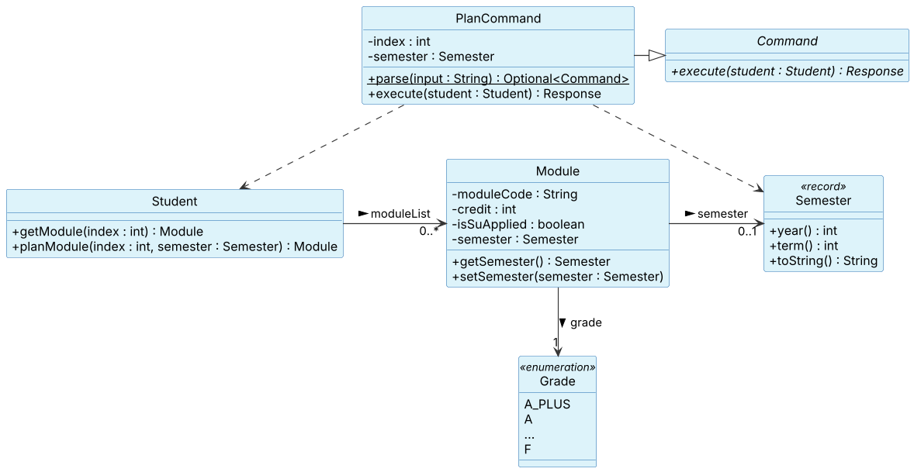

* `Semester` — an immutable record of a year (1 to 4) and a semester number (1 or 2). Its constructor throws `PlanException` for out-of-range values, so an invalid `Semester` cannot exist. `toString` gives the form `Y2S1`.
* `Module#semester` — `null` means the module is not planned yet. `Module#toString` adds the semester (for example `Y2S1`) at the end of the module line only when it is set, so planned modules show their semester in `list`, `add`, `edit` and `su` without any change to those commands.
* `PlanCommand#parse(String)` — claims any input that starts with `plan`. It matches `plan INDEX y/YEAR s/SEM`, converts the numbers (reporting non-numbers as a `PlanException`), and builds the `Semester`. A malformed command throws a `PlanException` with the usage message.
* `Student#planModule(int, Semester)` — gets the module with `getModule` and sets its semester. If the module is already planned, it is simply moved to the new semester.

Given below is an example usage scenario.

Step 1. The user has added `CS2113`, which is module 1 and is not planned.

Step 2. The user executes `plan 1 y/2 s/1`. `PlanCommand#parse` creates `Semester(2, 1)`, then a `PlanCommand` for index 1.

Step 3. `execute` calls `Student#planModule(1, semester)`, which sets the module's semester. The response is `Planned module 1 for Y2S1:` followed by the module line, which now ends with the semester `Y2S1`.

The following sequence diagram shows how the `plan 1 y/2 s/1` command goes through the `Dispatch` and `Domain` layers when it succeeds.

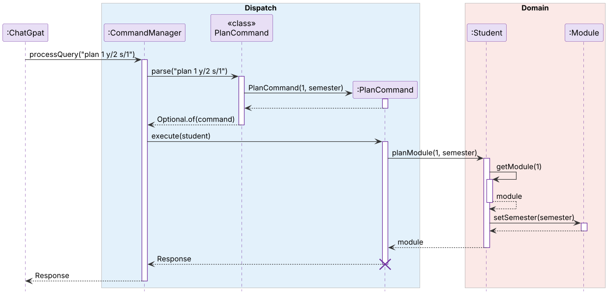

**Note:** The `Semester` object is created inside `PlanCommand#parse` and is not shown, to keep the diagram simple. If the index is out of range, `getModule` throws `InvalidIndexException`. If the year or semester is invalid, the `Semester` constructor throws `PlanException`. In both cases nothing is changed.

The following object diagrams show the first module before and after `plan 1 y/2 s/1`.

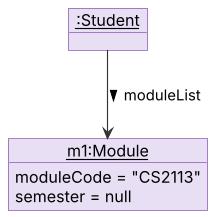
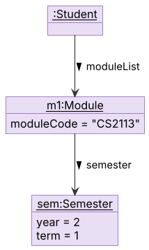

#### Design considerations

**Aspect: How a semester is represented**

* **Alternative 1 (current choice):** A separate `Semester` record that validates itself.
  * Pros: An invalid year or semester cannot exist, `equals` comes for free (used by `filter`), and the `Y2S1` format is defined in one place.
  * Cons: One more class.
* **Alternative 2:** Two plain `int` fields on `Module`.
  * Pros: No new class.
  * Cons: Validation and formatting are repeated wherever they are used, and the year can be set without the semester.

**Aspect: Representing "not planned"**

* **Alternative 1 (current choice):** A `null` semester.
  * Pros: Simple, existing modules and tests are unaffected, and saved data from before the feature can be loaded as unplanned.
  * Cons: Callers must check for `null`, or compare in a way that tolerates it (see the filter feature).
* **Alternative 2:** `Optional<Semester>` or a special "unplanned" constant.
  * Pros: Makes the unplanned case explicit.
  * Cons: More code, and `Optional` is not meant to be used as a field type.

**Aspect: Where the command lives**

* **Alternative 1 (current choice):** A separate `plan` command.
  * Pros: `edit` stays unchanged and the semester is set in one place.
  * Cons: One more command to learn.
* **Alternative 2:** Add optional `y/` and `s/` fields to `edit`.
  * Pros: Fewer commands.
  * Cons: `edit`'s validation gets more tangled, and the year and semester only make sense together.

### Unplan feature

#### Implementation

The unplan feature removes a module's semester again. It is facilitated by `UnplanCommand` and `Student#unplanModule(int)`, and reuses `Module#setSemester`.

* `UnplanCommand#parse(String)` — matches `unplan\s+(\d+)` and returns an `UnplanCommand`. It does not clash with `PlanCommand`, because that parser only claims input that starts with `plan`.
* `Student#unplanModule(int)` — gets the module with `getModule`. If its semester is `null`, it throws a `PlanException` saying the module is not planned. Otherwise it calls `setSemester(null)` and returns the module.
* `UnplanCommand#execute(Student)` — returns `Response.forDataChange(message, module)` to request an automatic save.

The following sequence diagram shows how `unplan 1` is processed.

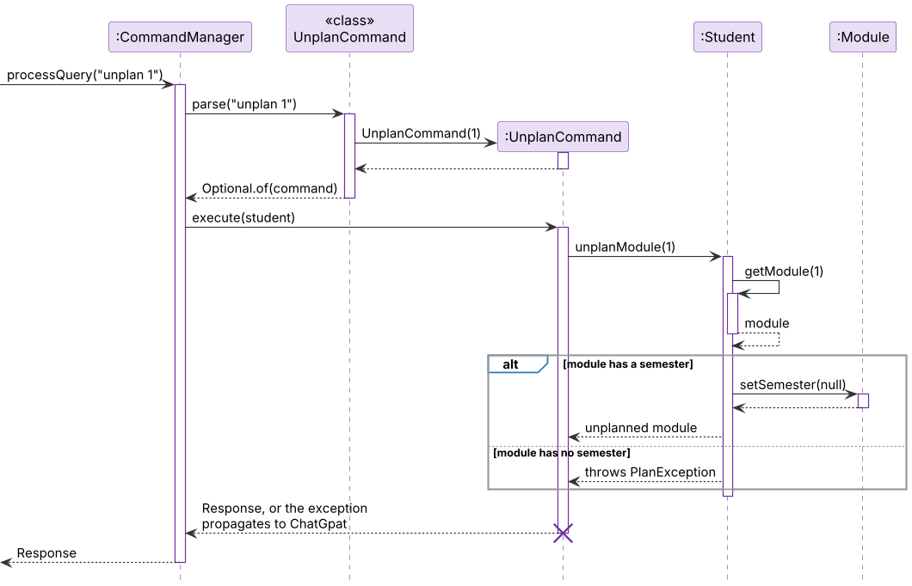

#### Design considerations

**Aspect: Unplanning a module that has no semester**

* **Alternative 1 (current choice):** Report an error.
  * Pros: The user learns that the command had no effect, which usually means a wrong index.
  * Cons: The command is not idempotent.
* **Alternative 2:** Succeed silently.
  * Pros: Safe to repeat.
  * Cons: A mistaken index goes unnoticed.

**Aspect: How the user clears a semester**

* **Alternative 1 (current choice):** A separate `unplan` command, paired with `plan` like `su` and `unsu`.
  * Pros: Consistent with the existing command pairs, and easy to remember.
  * Cons: One more command.
* **Alternative 2:** A special value such as `plan INDEX y/0 s/0`.
  * Pros: No new command.
  * Cons: An unclear special case that makes `Semester` validation harder.
    
### Filter feature

#### Implementation

The filter feature shows the modules of one semester, or the modules that are not planned yet, without changing the module list. It is facilitated by `FilterCommand`, `FilterUnplannedCommand` (both subclasses of `Command`) and two query methods in `Student`.

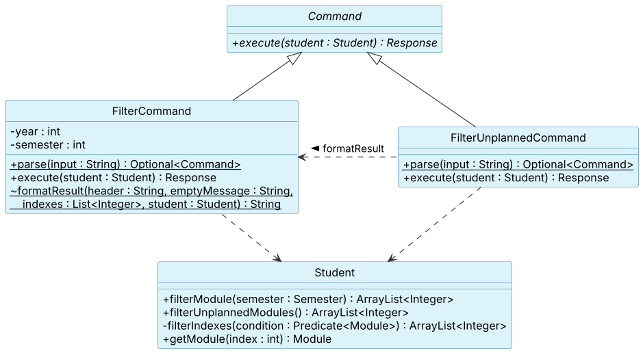

* `FilterCommand#parse(String)` — matches `filter\s+y/(\d+)\s+s/(\d+)`, converts the captured year and semester to integers, and returns a `FilterCommand`. Non-matching input returns `Optional.empty()` so the next parser can be tried.
* `FilterUnplannedCommand#parse(String)` — matches `filter\s+unplanned` and returns a `FilterUnplannedCommand`, or `Optional.empty()` otherwise. The two patterns cannot match the same input, so the order in which the parsers are registered does not matter.
* `Student#filterModule(Semester)` and `Student#filterUnplannedModules()` — each passes a condition to the private method `Student#filterIndexes(Predicate<Module>)`. It walks through `moduleList` and returns an `ArrayList<Integer>` of the **1-based indexes** of the modules that satisfy the condition. No module is removed or reordered.
* `FilterCommand#formatResult(...)` — a package-private static method that both commands use. It looks up each returned index with `Student#getModule(int)` and builds the text: a header, then one line per module with its original index. If there are no indexes, it returns the command's "empty" message instead.
* `FilterCommand#execute(Student)` — constructs a `Semester` from the parsed values, which throws `PlanException` if the year or semester is out of range. It then calls `Student#filterModule(semester)` and `formatResult`, with the header `Modules in Y2S1:` and the empty message `No modules found in Y2S1.` for the requested semester.
* `FilterUnplannedCommand#execute(Student)` — calls `Student#filterUnplannedModules()` and `formatResult`, with the header `Modules not planned for any semester:`. The empty message is `All modules are planned.`, or `No modules recorded yet.` when the student has no modules at all.

Given below is an example usage scenario.

Step 1. The user has five modules recorded. Modules 2 and 5 are planned for `Y2S1`, module 3 is planned for `Y1S2`, and modules 1 and 4 are not planned.

Step 2. The user executes `filter y/2 s/1`. `FilterCommand#parse` returns a command holding year 2 and semester 1.

Step 3. `execute(student)` constructs `Semester(2, 1)` and calls `Student#filterModule(semester)`, which returns `[2, 5]`. `formatResult` retrieves those two modules and the command displays them with their original indexes.

```text
Modules in Y2S1:
2. MA1521 | 4 MCs | Grade: B+ | Y2S1
5. CS2113 | 4 MCs | Grade: A- | Y2S1
```

The following sequence diagram shows how `filter y/2 s/1` is processed.

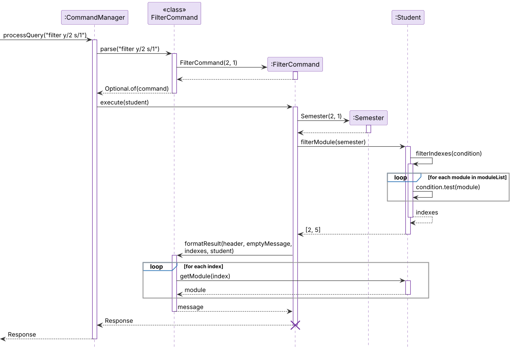

Step 4. The user then executes `filter unplanned`. `FilterUnplannedCommand#parse` returns a command, and `execute(student)` calls `Student#filterUnplannedModules()`, which returns `[1, 4]`.

```text
Modules not planned for any semester:
1. CS2040 | 4 MCs | Grade: A
4. MA1511 | 2 MCs | Grade: B
```

The following sequence diagram shows how `filter unplanned` is processed.

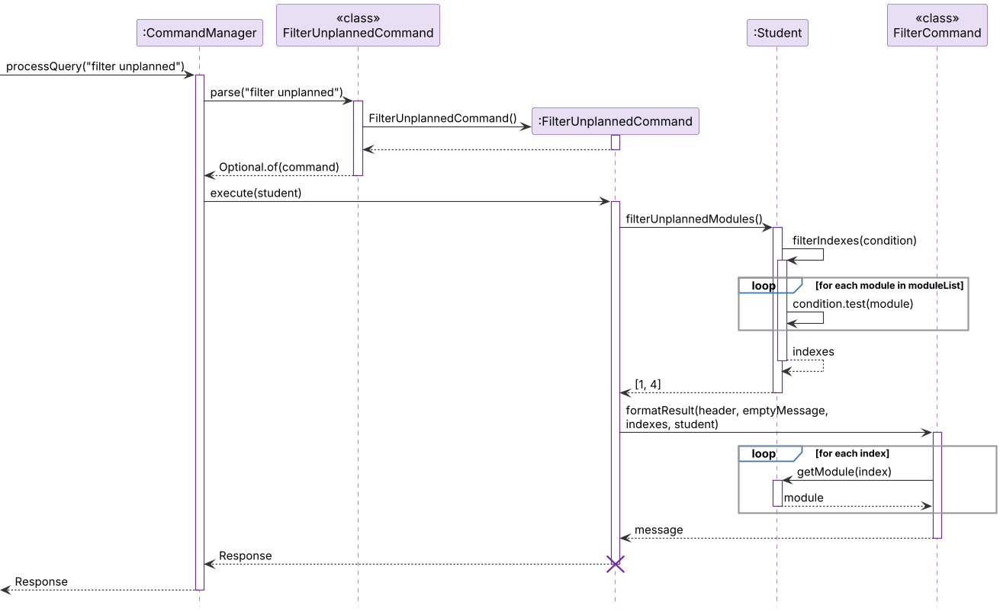

**Note:** The diagrams leave out how `FilterUnplannedCommand` chooses between its two empty messages (it checks `Student#getModuleCount()`). Filtering is read-only and does not request a storage save.

#### Design considerations

**Aspect: How filtered modules are identified**

* **Alternative 1 (current choice):** Return the original 1-based indexes from `Student`.
  * Pros: Indexes remain consistent with `list`, `delete`, `edit` and `plan`; no separate filtered index mapping is needed.
  * Cons: `formatResult` must call `getModule` for each matching index, and the displayed numbers may have gaps.
* **Alternative 2:** Return a new list of matching `Module` objects and number them consecutively.
  * Pros: Simple to render the filtered list.
  * Cons: Renumbering would be misleading because other commands use indexes from the full list.

**Aspect: How semester matching treats unplanned modules**

* **Alternative 1 (current choice):** Compare with `semester.equals(module.getSemester())`, so the requested `Semester` (which is never `null`) is the one that is asked.
  * Pros: Reuses the `Semester` value object's equality, and an unplanned module (`null` semester) simply does not match, without a separate null check.
  * Cons: The order of the two operands matters. Writing `module.getSemester().equals(semester)` throws a `NullPointerException` for unplanned modules, so a test covers this case.
* **Alternative 2:** Group modules by semester in a map and look up the selected semester.
  * Pros: Convenient if repeated filtering and other semester-based queries become common.
  * Cons: Adds extra bookkeeping and complexity for a simple read-only command.

**Aspect: How `filter unplanned` is added**

* **Alternative 1 (current choice):** A separate `FilterUnplannedCommand` with its own pattern.
  * Pros: Each command has one pattern and one purpose, and `FilterCommand`'s parsing and tests stay unchanged.
  * Cons: One more class, and the two commands must share their output code.
* **Alternative 2:** Extend `FilterCommand` so that `y/` and `s/` are optional, or accept the word `unplanned` instead.
  * Pros: Only one command class.
  * Cons: `FilterCommand` needs a mode flag or nullable fields, and both `parse` and `execute` branch on it, which makes them harder to read and test.

**Aspect: How the two filters share code**

* **Alternative 1 (current choice):** One private `Student#filterIndexes(Predicate<Module>)` for the loop and one `FilterCommand#formatResult` for the output.
  * Pros: The loop and the output format exist once, so a new filter only needs a new condition and a header.
  * Cons: `FilterUnplannedCommand` depends on a package-private method of `FilterCommand`.
* **Alternative 2:** Copy the loop and the formatting into each command.
  * Pros: The commands are independent of each other.
  * Cons: Duplicated code, so a change in the output format must be made in two places.

The filter feature is covered by `FilterCommandTest` and `FilterUnplannedCommandTest`. They check parsing, the output for matching and empty results, that original indexes are kept, that invalid years and semesters throw `PlanException`, and that unplanned modules are never matched by a semester filter.

### Summary feature

#### Implementation

`summary` displays module counts, MCs and GPA by semester.

* `SummaryCommand#parse(String)` accepts `summary` and ignores arguments separated by whitespace.
* `Student#getSemesterSummaries()` groups modules in a `TreeMap`, ordered by year and term, with the unplanned group last. It returns `SemesterSummary` records without reordering the original module list.
* All modules count towards totals. The shared `calculateGpaData(Iterable<Module>)` helper excludes S/U modules and `CS`/`CU` grades from GPA.
* `SummaryCommand#execute(Student)` formats GPA to two decimal places using `Locale.ROOT`, or `GPA n/a` when no credits contribute. The unplanned line has no GPA and always appears, including `Unplanned | 0 modules | 0 MCs` for empty records.

#### Design considerations

Grouping and calculations stay in `Student`; the command formats the response. Reusing the GPA helper keeps exclusions consistent. This read-only command does not request a save.

**Verification:** `SummaryCommandTest` covers ordering, totals, exclusions, empty records and locale-independent formatting. `CommandManagerTest` checks summaries after module changes.

### SU feature

#### Implementation

The SU feature is facilitated by `SuCommand` (a subclass of `Command`), `Student#applySu(int)`, and `Student#getRemainingSuQuota()`. It marks a module as SU-ed, excludes it from GPA calculations, and consumes the module's MCs from the available SU quota.

* `SuCommand#parse(String)` — matches `su\s+(\d+)`, converts the captured 1-based index to an integer, and returns a `SuCommand`. Non-matching input returns `Optional.empty()`.
* `Student#applySu(int)` — retrieves the module through `getModule(index)`, rejects an already SU-ed module or one whose credits exceed the remaining quota with `SuException`, and otherwise calls `Module#setSu(true)` before returning the module.
* `Student#getRemainingSuQuota()` — subtracts `getUsedSuMcs()` (the sum of credits for SU-ed modules) from the student's total `suQuota`.
* `SuCommand#execute(Student)` — calls `applySu(index)`, obtains the remaining quota, and returns `Response.forDataChange(message, module)` so the updated record is saved.

Given below is an example usage scenario.

Step 1. The student has 28 MCs of SU quota, none used, and module 2 is `MA1521 | 4 MCs | Grade: B+`.

Step 2. The user executes `su 2`. `SuCommand#parse` creates a command holding index 2.

Step 3. `execute(student)` calls `Student#applySu(2)`. The module is not already SU-ed and 4 MCs fit within the quota, so its SU flag is set to true. The remaining quota becomes 24 MCs, and the command requests an automatic save.

```text
Applied SU on module 2: MA1521 | 4 MCs | Grade: B+ [S/U]
Remaining SU quota: 24 MCs.
```

The following sequence diagram shows how `su 2` is processed.

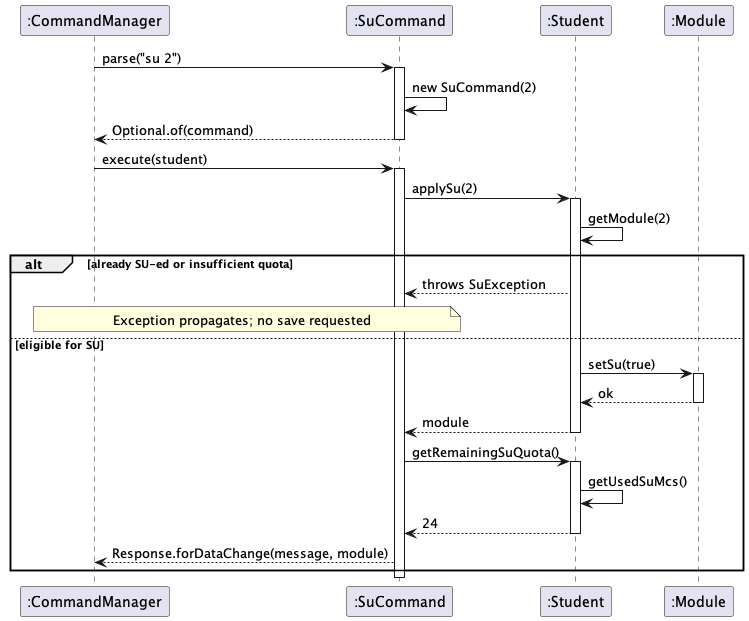

**Note:** An invalid index causes `InvalidIndexException` in `getModule`. A repeated SU operation or insufficient remaining quota causes `SuException` before `setSu(true)`, leaving the module unchanged. SU-ed modules are excluded from GPA calculations, but their original grades remain stored.

#### Design considerations

**Aspect: How SU quota is maintained**

* **Alternative 1 (current choice):** Calculate used MCs from modules marked SU-ed each time.
    * Pros: The quota stays consistent when modules are edited, deleted, or have SU removed; no extra counter can become out of sync.
    * Cons: Each quota check iterates over the module list.
* **Alternative 2:** Maintain a separate mutable counter of used SU credits.
    * Pros: Constant-time quota lookup.
    * Cons: Every operation affecting module credits or SU status must update the counter correctly.

**Aspect: How SU affects module grades**

* **Alternative 1 (current choice):** Keep the original grade and store SU status as a separate boolean.
    * Pros: Removing SU restores GPA participation without losing the original grade.
    * Cons: GPA calculations must explicitly exclude SU-ed modules.
* **Alternative 2:** Replace the grade with a non-GPA grade when SU is applied.
    * Pros: GPA exclusion could rely on grade type alone.
    * Cons: The original grade would be lost unless stored separately.

### UnSU feature

#### Implementation

The UnSU feature is facilitated by `UnsuCommand` (a subclass of `Command`), `Student#removeSu(int)`, and `Student#getRemainingSuQuota()`. It removes a module's SU status, restores its eligibility for GPA calculations when its grade affects GPA, and releases its MCs back to the SU quota.

* `UnsuCommand#parse(String)` — matches `unsu\s+(\d+)`, converts the captured 1-based index to an integer, and returns an `UnsuCommand`, or `Optional.empty()` for non-matching input.
* `Student#removeSu(int)` — retrieves the module with `getModule(index)`, throws `SuException` if it is not currently SU-ed, and otherwise calls `Module#setSu(false)` and returns the module.
* `Student#getRemainingSuQuota()` — recalculates remaining MCs from the modules that are still SU-ed.
* `UnsuCommand#execute(Student)` — calls `removeSu(index)`, formats the module and remaining quota, and returns `Response.forDataChange(message, module)` to request a save.

Given below is an example usage scenario.

Step 1. Module 2 is `MA1521 | 4 MCs | Grade: B+ [S/U]`, and the student has 24 MCs of remaining SU quota.

Step 2. The user executes `unsu 2`. `UnsuCommand#parse` creates a command holding index 2.

Step 3. `execute(student)` calls `Student#removeSu(2)`, which clears the SU flag. The remaining quota increases to 28 MCs, and the command returns a response requesting an automatic save.

```text
Removed SU on module 2: MA1521 | 4 MCs | Grade: B+
Remaining SU quota: 28 MCs.
```

The following sequence diagram shows how `unsu 2` is processed.

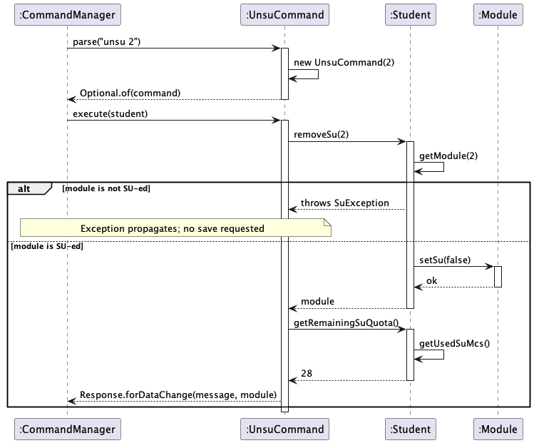

**Note:** An invalid index throws `InvalidIndexException`, and trying to remove SU from a module that is not SU-ed throws `SuException`. Neither failure changes the module. Removing SU does not change the stored grade; a grade such as `CS` or `CU` still does not contribute to GPA.

#### Design considerations

**Aspect: Handling modules that are not SU-ed**

* **Alternative 1 (current choice):** Throw `SuException` without modifying the module.
    * Pros: Alerts the user to an unnecessary operation or a potentially incorrect index.
    * Cons: The command is not idempotent.
* **Alternative 2:** Treat repeated UnSU operations as successful.
    * Pros: Safe to repeat without an error.
    * Cons: May hide user mistakes.

**Aspect: How SU status is reversed**

* **Alternative 1 (current choice):** Set the existing module's SU flag to false.
    * Pros: Preserves its grade, credits, code and semester; the quota is automatically recalculated.
    * Cons: Requires mutable `Module` state.
* **Alternative 2:** Replace the module with a newly constructed non-SU module.
    * Pros: Can support an immutable module model.
    * Cons: Must copy every other module field and preserve its original list position.

### GPA feature

#### Implementation

The GPA feature is facilitated by `GpaCommand` (a subclass of `Command`) and `Student#calculateGpa()`. It shows the student's GPA as a credit-weighted average of the grade points of all modules that count towards GPA. It does not change any data.

* `GpaCommand#parse(String)` — matches `gpa(\s.*)?`, so extra text after `gpa` is ignored as stated in the User Guide, and returns a `GpaCommand`. Non-matching input returns `Optional.empty()` so the next parser can be tried.
* `GpaCommand#execute(Student)` — calls `Student#calculateGpa()` and returns a `Response` containing `Your GPA is %.2f`. It uses the plain `Response` constructor, so no storage save is requested.
* `Student#calculateGpa()` — calls the private helper `calculateGpaData(Iterable<Module>)`, then divides the total grade points by the total credits. If no module contributes, it throws `GpaException`.
* `Student#calculateGpaData(Iterable<Module>)` — loops through the modules and skips any module that is SU-ed or whose `Grade#isAffectsGpa()` is false (such as `CS` and `CU`). For every other module it adds `Grade#getGradePoint() × credits` to the total grade points and the credits to the total credits, and returns both in a `GpaData` record.

Given below is an example usage scenario.

Step 1. The student has three modules recorded, none SU-ed: `CS2113 | 4 MCs | Grade: A-` (module 1), `MA1521 | 4 MCs | Grade: B+` (module 2) and `CS2040 | 4 MCs | Grade: A` (module 3).

Step 2. The user executes `gpa`. `GpaCommand#parse` returns a `GpaCommand`.

Step 3. `execute(student)` calls `Student#calculateGpa()`. The three modules contribute 4.5 × 4 + 4.0 × 4 + 5.0 × 4 = 54 grade points over 12 credits, so the GPA is 4.50.

```text
Your GPA is 4.50
```

If the user then executes `su 2`, module 2 is skipped and `gpa` shows `Your GPA is 4.75` ((18 + 20) ÷ 8).

The following sequence diagram shows how `gpa` is processed.

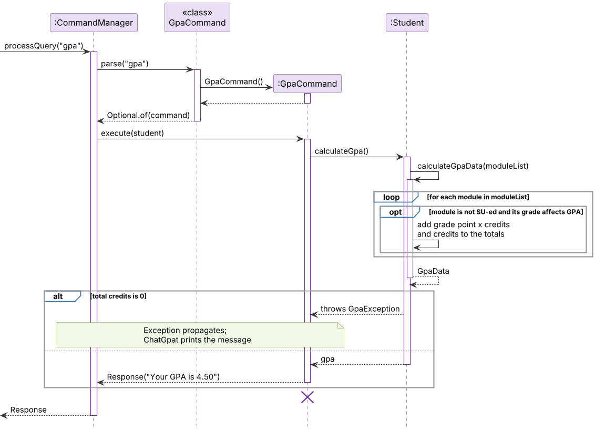

**Note:** If every module is SU-ed, has a non-GPA grade, or there are no modules at all, the total credits is 0. `Student#calculateGpa()` then throws `GpaException` with the message `No modules contribute to GPA. Add a graded module first.`, which `ChatGpat` prints like any other expected error. The original grades of SU-ed modules are not touched, so removing SU brings them back into the GPA.

#### Design considerations

**Aspect: How the modules that count towards GPA are chosen**

* **Alternative 1 (current choice):** Use one private helper, `calculateGpaData`, that returns the grade points and credits of the modules that count.
  * Pros: One place decides which modules count, so `gpa`, `target` and `summary` (which reuse the helper) always agree.
  * Cons: The module list is read again every time a GPA is needed.
* **Alternative 2:** Keep a running GPA total in `Student` and update it whenever a module is added, edited, deleted or SU-ed.
  * Pros: Constant-time lookup.
  * Cons: Every command that changes a grade, credit or SU status must update the total correctly, and one missed update would show a wrong GPA.

**Aspect: What to show when no module counts towards GPA**

* **Alternative 1 (current choice):** Throw `GpaException` with a message that tells the user what to do.
  * Pros: Avoids a division by zero and does not show a number that looks real but means nothing.
  * Cons: The user sees an error for a situation that is not really a mistake.
* **Alternative 2:** Show `Your GPA is 0.00`.
  * Pros: No error handling is needed.
  * Cons: 0.00 is a valid GPA (all F grades), so the user could not tell the two cases apart.

### Quota feature

#### Implementation

The quota feature is facilitated by `QuotaCommand` (a subclass of `Command`), `Student#getRemainingSuQuota()` and `Student#getUsedSuMcs()`. It shows how many SU credits the student can still use and lists every module that has been SU-ed. It does not change any data.

* `QuotaCommand#parse(String)` — matches `quota(\s.*)?`, so extra text after `quota` is ignored as stated in the User Guide, and returns a `QuotaCommand`. Non-matching input returns `Optional.empty()`.
* `QuotaCommand#execute(Student)` — calls `Student#getRemainingSuQuota()`, then builds the list of SU-ed modules and returns both in one `Response`. It uses the plain `Response` constructor, so no storage save is requested.
* `Student#getRemainingSuQuota()` — subtracts `getUsedSuMcs()` from the student's total SU quota (28 MCs by default).
* `Student#getUsedSuMcs()` — adds up the credits of every module for which `Module#isSu()` is true.
* `QuotaCommand#buildSuList(Student)` — goes through positions 1 to `Student#getModuleCount()`, fetches each module with `Student#getModule(int)`, and keeps the ones that are SU-ed. Each line shows the module's position in the **full** list, so the number can be used directly with `unsu INDEX`.

Given below is an example usage scenario.

Step 1. The student has the quota of 28 MCs and three modules recorded. Module 2 is `MA1521 | 4 MCs | Grade: B+` and has been SU-ed with `su 2`.

Step 2. The user executes `quota`. `QuotaCommand#parse` returns a `QuotaCommand`.

Step 3. `execute(student)` calls `Student#getRemainingSuQuota()`, which counts 4 used MCs and returns 24. `buildSuList` then finds module 2 as the only SU-ed module and adds it to the response.

```text
Remaining SU quota: 24 MCs.
Modules SU-ed so far:
  2. MA1521 | 4 MCs | Grade: B+ [S/U]
```

If no module is SU-ed, the second part of the message is `No modules have been SU-ed yet.` instead of the list.

The following sequence diagram shows how `quota` is processed.

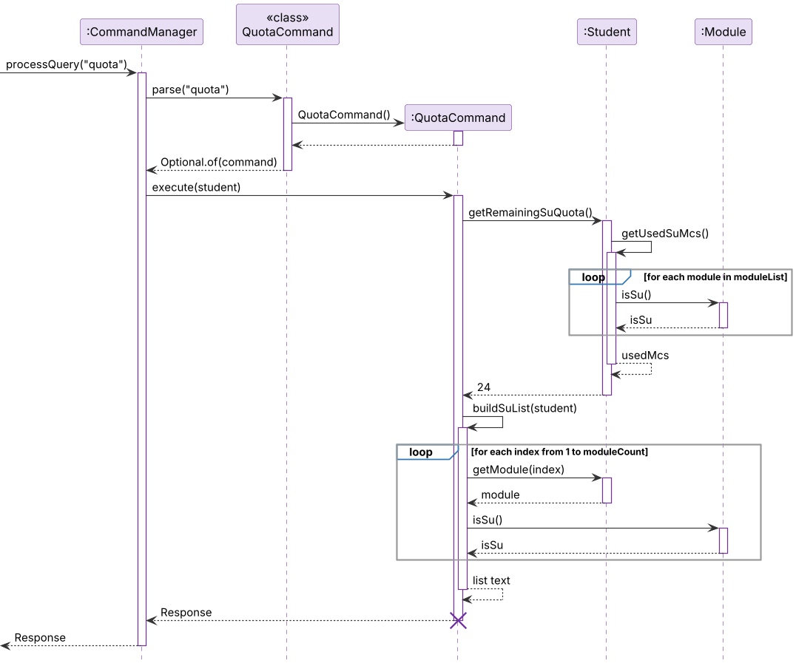

**Note:** The used quota is calculated from the SU flags of the modules every time, as explained in the design considerations of the SU feature. Because of this, `quota` always matches the result of `su`, `unsu`, `edit` and `delete`, and a module that is deleted gives its SU credits back.

#### Design considerations

**Aspect: Where the remaining quota is calculated**

* **Alternative 1 (current choice):** `Student` calculates it, and `su`, `unsu` and `quota` all call the same method.
  * Pros: The three commands always show the same number, and `QuotaCommand` stays small.
  * Cons: `QuotaCommand` still depends on two `Student` methods, one for the number and one for the module list.
* **Alternative 2:** `QuotaCommand` adds up the SU-ed credits itself.
  * Pros: `Student` stays smaller.
  * Cons: The rule for the quota would be written in two places and could drift apart.

**Aspect: How SU-ed modules are numbered in the list**

* **Alternative 1 (current choice):** Show each module's position in the full module list.
  * Pros: The number matches `list`, so the user can type `unsu 2` straight from the `quota` output.
  * Cons: The numbers can have gaps, for example 2 and 5.
* **Alternative 2:** Number the SU-ed modules from 1.
  * Pros: Looks tidier.
  * Cons: `unsu 1` would act on a different module from the one shown as 1, which is easy to get wrong.

### Target GPA feature

#### Implementation

The target GPA feature is facilitated by `TargetGpaCommand`, `Student#targetGPA(double, int)`, `Student#calculateGpaData(Iterable<Module>)` and `Grade#estimateLetterGrade(double)`. It calculates the average grade point needed over the remaining modular credits to reach a desired cumulative GPA.

* `TargetGpaCommand#parse(String)` — matches `target\\s+(\\S+)\\s+r/(\\S+)`, converts the target to a `double` and the remaining MCs to an `int`, and creates a `TargetGpaCommand`. If the pattern does not match, it returns `Optional.empty()`. Numeric conversion errors can propagate as `NumberFormatException`.
* `TargetGpaCommand#execute(Student)` — calls `Student#targetGPA(target, remainingMcs)` and wraps the returned message in a `Response`.
* `Student#calculateGpaData(Iterable<Module>)` — iterates through the supplied modules and returns a private `GpaData` record containing the total weighted grade points and GPA-contributing credits. S/U modules and grades such as `CS` and `CU` are excluded.
* `Student#targetGPA(double, int)` — checks that the target is greater than 0 and at most 5.0, and that the remaining MCs are positive. It throws `TargetException` for invalid values and `GpaException` when no recorded module contributes to GPA. It then calculates the required average and returns the appropriate message.
* `Grade#estimateLetterGrade(double)` — provides the approximate letter grade shown alongside a reachable required average.

Let `P` be the current weighted grade-point total, `C` the current GPA-contributing MCs, `F` the remaining MCs, and `T` the target GPA. The required future average `R` is:

```text
R = (T × (C + F) − P) ÷ F
```

Given below is an example usage scenario.

Step 1. The student has recorded `CS2113` (4 MCs, A-) and `MA1521` (4 MCs, B+). The current GPA is 4.25 over 8 MCs, so `P = 34`.

Step 2. The user executes `target 4.50 r/8`. `TargetGpaCommand#parse` constructs a command with target 4.50 and 8 remaining MCs.

Step 3. `execute(student)` calls `Student#targetGPA(4.50, 8)`. The required average is `(4.50 × 16 − 34) / 8 = 4.75`. The returned `Response` includes the current GPA, required grade point and an approximate letter grade.

The following sequence diagram shows how `target 4.50 r/8` is processed. Its `calculateGpaData()` call now takes `moduleList` as an argument.

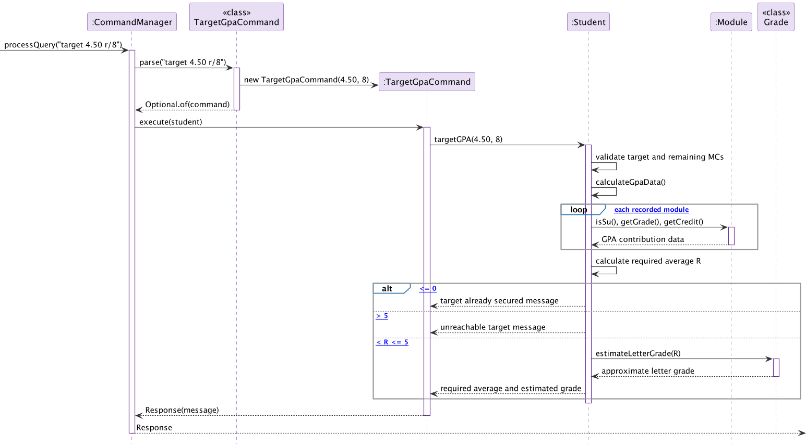

**Note:** `Student#targetGPA` handles three outcomes: if `R <= 0`, the target is already secured; if `R > 5`, it reports the best achievable GPA assuming 5.0 in every remaining MC; otherwise it reports `R` and an approximate letter grade. Invalid target values or remaining MCs are rejected before calculation. The current implementation uses `target <= 0` as its lower-bound check, although its exception text describes the interval as inclusive of 0.0.

#### Design considerations

**Aspect: Where the GPA calculation is performed**

* **Alternative 1 (current choice):** `Student#targetGPA` performs the calculation, while `TargetGpaCommand` handles parsing and creates the `Response`.
  * Pros: Keeps GPA business rules in the domain layer and makes the command straightforward to test.
  * Cons: Adds calculation and message-formatting responsibilities to `Student`.
* **Alternative 2:** Calculate the required average inside `TargetGpaCommand`.
  * Pros: Keeps the calculation close to its command.
  * Cons: Duplicates GPA-related logic and mixes command processing with domain rules.

**Aspect: How GPA totals are reused**

* **Alternative 1 (current choice):** Use a private `GpaData` record returned by `calculateGpaData(Iterable<Module>)`.
  * Pros: Overall, target and semester GPA calculations share the same credit-weighted totals and exclusions.
  * Cons: Requires an additional helper method and record.
* **Alternative 2:** Recompute totals separately in `calculateGpa()` and `targetGPA()`.
  * Pros: Fewer helper declarations.
  * Cons: Repeats iteration logic and risks inconsistent exclusions.

### Exit feature

#### Implementation

`ExitCommand` accepts `exit` with optional whitespace-separated arguments and returns `Goodbye!` with `Response.isExit()` set to `true`. `ChatInterface` prints the message without another prompt, then `ChatGpat#run` returns.

#### Design considerations

The response flag keeps application termination in the main loop. Exit does not trigger a save: successful data-changing commands already save automatically.

**Verification:** `ExitCommandTest` checks parsing and the farewell response; `CommandManagerTest` checks dispatch and the exit flag.

### Local storage

`Storage` owns the UTF-8 file at `data/modules.txt`, relative to the process working directory. Its constructor also accepts a `Path` so tests can use JUnit's `@TempDir`. No file is created by loading a missing path.

The file format has no header and stores one module per physical line. These positions are the persistence contract for future features:

| Position | Field | Validation / default |
| --- | --- | --- |
| 1 | Module code | Required, non-empty, no whitespace; case-insensitive uniqueness |
| 2 | MCs | Required positive Java `int` |
| 3 | Original grade | Required `Grade` label, including `CS` and `CU` |
| 4 | S/U flag | `0` or `1`; omitted/empty defaults to `0` |
| 5 | Semester | `Y1S1` through `Y4S2`, or `-`; omitted/empty is unplanned |
| 6 | Module name | Omitted/empty defaults to the code |
| 7 | Module description | Omitted/empty defaults to an empty string |

Fields are separated by unescaped `|`, with optional surrounding spaces. The writer emits all seven fields. The reader accepts three to seven fields, ignores blank lines, and tolerates a UTF-8 byte order mark. Names and descriptions are saved even though `add` currently supplies the code as the name and an empty description.

Escapes are `\|`, `\\`, `\n`, `\r`, `\t`, and `\s` (literal space). The reader trims separator padding before decoding. The writer escapes boundary spaces so they survive a round trip. Unknown or incomplete escapes invalidate only that line. Extra fields currently invalidate a line, helping catch accidental unescaped pipes.

**Extending the format:** Append new optional fields; do not reorder or reuse these positions. Update `Storage`'s parser, writer and field-count limit together, give each added field a default for shorter records, update this table, and add a round-trip test. Backward compatibility means new releases read old records; it does not promise that old releases read new fields.

**Startup:** `ChatGpat.run` calls `Storage.load()`, adds the returned modules to the student, then passes `LoadResult.warnings()` to `ChatInterface.printWelcome`. Validation and duplicate detection happen per line, so a bad record cannot stop later records loading. Read errors return warnings. Storage neither prints nor logs to the console.

**Commands:** Successful mutating commands return `Response.forDataChange(message, module)`. `ChatGpat` checks `isDataChanged()`, saves `student.getModules()`, and passes any save error to `ChatInterface` alongside the command response. Viewing commands use the ordinary response constructors; failed commands throw before returning a save request. Future commands that modify persisted data must use `forDataChange` too.

**Saving:** The writer creates parent directories as needed, writes a sibling temporary file, then replaces the destination atomically where supported (falling back to a normal replacement where atomic moves are unavailable). This avoids truncating the existing file during serialization or writing. I/O and access errors return a message instead of escaping the command loop. Temporary-file cleanup is attempted on success and failure. The in-memory state is retained after a save failure; the next successful mutating command retries the full list.

**Verification:** `StorageTest` covers a real save/load round trip, escaped text, legacy defaults, malformed lines and duplicates, missing/unreadable files, and failed saves. `ChatGpatTest` verifies that each of the seven mutating commands saves before its response, sessions restore saved state, viewing/rejected commands do not rewrite the file, and save errors reach the UI while commands continue working.

## Product scope

### Target user profile

ChatGpat is for NUS Computing students who are strategic about their GPA, especially those working towards a GPA-dependent goal such as a student exchange (SEP) place or a scholarship. The target user:

* has to keep track of many modules across several semesters
* has a limited S/U quota and needs to decide which modules to use it on
* wants to know what GPA to aim for in the remaining modules to reach a target
* prefers typing commands to clicking through a spreadsheet or a web app
* is comfortable using a command-line application

### Value proposition

Students working towards a GPA goal usually track their grades and S/U decisions in spreadsheets or in their heads. Updating a spreadsheet by hand is slow and easy to get wrong, and an S/U decision cannot be undone once it is made.

ChatGpat keeps the student's modules, grades and semester plan in one place and answers with one typed command:

* **What is my GPA now?** It calculates the GPA from the recorded grades, leaving out modules that are marked S/U.
* **What if I S/U this module, or get a different grade?** `su`, `unsu` and `edit` change one module, so the student can compare the GPA before and after, and `quota` shows how much S/U quota is left.
* **What do I need to reach my target?** The target GPA command shows the average grade needed in the remaining modules.
* **What is my plan?** `plan` places a module in a year and semester, `unplan` removes it, and `filter` lists the modules of one semester or those not planned yet.

This lets the student make informed S/U decisions and plan ahead which modules to put the most effort into.

## User Stories

|Version| As a ... | I want to ... | So that I can ...|
|-------|----------|---------------|------------------|
|v1.0|new user|see usage instructions|refer to them when I forget how to use the application|
|v1.0|student|add a module with its units and grade|have it counted correctly towards my GPA|
|v1.0|student|view all my recorded modules|check everything I have entered and see each module's number|
|v1.0|student|edit a module's code, units or grade|correct a mistake or try a different grade without re-entering the module|
|v1.0|student|delete a module|stop a wrongly entered module from being counted in my calculations|
|v1.0|student|see my current GPA|know where I stand|
|v1.0|student|mark a module as S/U|see my GPA without that module before I commit to using the S/U|
|v1.0|student|remove the S/U mark from a module|change my mind and have the module counted again|
|v1.0|student|check how much of my S/U quota is left|avoid going over the limit|
|v2.0|student|plan a module for a year and semester|organise which modules I will take in each semester|
|v2.0|student|remove a module from its semester plan|update my plan when it changes|
|v2.0|student|filter my modules by year and semester|see what I have planned for one semester|
|v2.0|student|filter my modules that are not planned yet|find which modules still need a semester|
|v2.0|student|see a summary of my modules by semester|compare my semesters at a glance|
|v2.0|student with a GPA goal|set a target GPA|see the average grade I need in my remaining modules to reach it|
|v2.0|student|have my modules saved after changes and loaded when I return|avoid re-entering my records every time|

## Non-Functional Requirements

1. Should work on any mainstream OS (Windows, Linux, macOS) that has Java 25 or above installed.
2. Should work offline, without an internet connection.
3. A user with above-average typing speed for regular English text (not code) should be able to complete most tasks faster by typing commands than by using the mouse.
4. Should respond to every command without noticeable delay when up to 100 modules are recorded.
5. GPA calculations should follow the NUS grade-point scale.
6. A command with invalid input should never crash the program or change the stored data. The user should get an error message that explains what went wrong.
7. Should be usable by a student who has not used the application before, with the `help` command listing every available command.

## Glossary

* *GPA* - Grade point average: the average of the grade points of the recorded modules, weighted by their MCs. NUS calls this the CAP, but ChatGpat calls it GPA.
* *Grade point* - The number that a letter grade is worth on the NUS scale. It is used in the GPA calculation.
* *MC* - Modular Credit: the weight of a module. A module worth 4 MCs counts twice as much in the GPA as a module worth 2 MCs.
* *S/U (SU)* - The NUS option to have a module graded Satisfactory/Unsatisfactory instead of with a letter grade, so that it does not count towards the GPA. In ChatGpat, applying SU to a module only leaves it out of the GPA calculation, so that the student can see the effect. It does not change anything in the real NUS records.
* *SU quota* - The number of MCs of modules a student may S/U. ChatGpat shows the remaining quota after each `su` and `unsu`.
* *Index* - The position of a module in the list shown by `list`, starting from 1. Commands such as `edit`, `delete`, `su`, `unsu`, `plan` and `unplan` use it to pick a module.
* *Semester notation* - A semester is written as `Y2S1`, meaning year 2, semester 1. Years go from 1 to 4 and semesters from 1 to 2.
* *Planned module* - A module that has been placed in a year and semester with `plan`. A module that has not is an *unplanned module*.
* *Target GPA* - The GPA that the student wants to reach. The `target` command shows the average grade needed in the remaining MCs to reach it.
* *SEP* - The NUS Student Exchange Programme.
* *CLI* - Command-line interface: an application that the user controls by typing commands.
* *Mainstream OS* - Windows, Linux, Unix and macOS.

## Instructions for manual testing

Given below are instructions to test ChatGpat manually.

**Note:** These instructions only provide a starting point for testers. Testers are expected to do more exploratory testing. All tests assume you start ChatGpat as described in the User Guide.

### Launch and exit

#### Showing the help message

1. Test case: `help`<br>Expected: `Available commands:` followed by every command with its format: `help`, `add`, `list`, `edit`, `delete`, `gpa`, `summary`, `su`, `unsu`, `quota`, `target`, `plan`, `unplan`, `filter` and `exit`.

#### Exiting the program

1. Test case: `exit`<br>Expected: `Goodbye!` is shown and the program ends.

#### Unknown commands

1. Test case: `hello`<br>Expected: An error saying the command is not known. The program keeps running.

### Adding and listing modules

#### Adding modules

Prerequisites: no modules are recorded. `list` shows `No modules recorded yet.`

1. Test case: `add m/CS2113 c/4 g/A-`<br>Expected: `New module added: CS2113 (4 MCs, Grade: A-)` and `You now have 1 module recorded.`
1. Test case: `add m/MA1521 c/4 g/B+`, then `add m/CS2040 c/4 g/A`<br>Expected: The module is added each time, and the count goes to 2 and then 3.
1. Test case: `add m/CS2113 c/4 g/A-` again<br>Expected: An error saying the module is already recorded. The count does not change.
1. Test case: `add CS2113`<br>Expected: An error. Nothing is added.

#### Listing modules

Prerequisites: the three modules above are recorded.

1. Test case: `list`<br>Expected: `Here are your recorded modules:` followed by three modules, numbered 1 to 3 in the order they were added, each with its MCs and grade.

### Editing and deleting modules

#### Editing a module

Prerequisites: the three modules above are recorded.

1. Test case: `edit 2 c/5 g/A`<br>Expected: `Updated module 2:` followed by MA1521 with 5 MCs and grade A. The code is unchanged.
1. Test case: `edit 2 c/4 g/B+`<br>Expected: Module 2 is back to 4 MCs and grade B+. Run this to restore the data for the later tests.
1. Test case: `edit 2`<br>Expected: An error showing the usage of `edit`. Module 2 is unchanged.
1. Test case: `edit 99 g/A`<br>Expected: An error about an invalid index. Nothing is changed.
1. Test case: `edit 1 m/MA1521`<br>Expected: An error, because another module already uses that code. Module 1 is unchanged.

#### Deleting a module

Prerequisites: the three modules above are recorded.

1. Test case: `delete 3`<br>Expected: `Removed module 3:` followed by CS2040. `list` now shows two modules.
1. Test case: `add m/CS2040 c/4 g/A`<br>Expected: CS2040 is back as module 3. Run this to restore the data for the later tests.
1. Test case: `delete 99`<br>Expected: An error about an invalid index. No module is removed.

### GPA and S/U

#### Showing the GPA

Prerequisites: CS2113 (4 MCs, A-), MA1521 (4 MCs, B+) and CS2040 (4 MCs, A) are recorded as modules 1 to 3.

1. Test case: `gpa`<br>Expected: `Your GPA is 4.50`, which is the weighted average of 4.5, 4.0 and 5.0 on the NUS scale.

#### Applying and removing S/U

Prerequisites: the same three modules, none marked S/U.

1. Test case: `su 2`<br>Expected: `Applied SU on module 2:` followed by the module and `Remaining SU quota:` with a number of MCs.
1. Test case: `gpa`<br>Expected: `Your GPA is 4.75`. Module 2 is no longer counted.
1. Test case: `quota`<br>Expected: `Modules SU-ed so far:` followed by module 2.
1. Test case: `su 2` again<br>Expected: An error, because the module already has SU applied. Nothing is changed.
1. Test case: `unsu 2`<br>Expected: `Removed SU on module 2:` followed by the module and the remaining SU quota, which is back to what it was before `su 2`. `gpa` again shows `Your GPA is 4.50`.
1. Test case: `su 99`<br>Expected: An error about an invalid index. Nothing is changed.

#### Checking the quota when nothing is SU-ed

Prerequisites: no module is marked S/U.

1. Test case: `quota`<br>Expected: `No modules have been SU-ed yet.`

### Target GPA and summary

#### Calculating the average grade needed

Prerequisites: the same three modules, none marked S/U.

1. Test case: `target 4.5 r/12`<br>Expected: A message stating the average grade needed in the remaining 12 MCs to reach a GPA of 4.5, or that the target cannot be reached.
1. Test case: `target 4.5`<br>Expected: An error, because the remaining MCs (`r/`) are missing. No result is shown.

#### Showing the summary

Prerequisites: the same three modules, none planned.

1. Test case: `summary`<br>Expected: The module count, MCs and GPA for each semester that has modules, and the totals for the unplanned modules. All three modules are counted as unplanned.
1. Test case: plan two of them with the commands in the next section, then `summary`<br>Expected: The planned modules are counted under their semesters. Only the rest are counted as unplanned.

### Planning, unplanning and filtering

#### Planning and unplanning a module

Prerequisites: at least three modules are recorded, and `list` shows no semester on any of them.

1. Test case: `plan 1 y/2 s/1`<br>Expected: The response starts with `Planned module 1 for Y2S1:`, and `list` now shows `Y2S1` on module 1.
1. Test case: `plan 1 y/5 s/1`<br>Expected: An error saying the year is invalid. Module 1 is unchanged.
1. Test case: `plan 99 y/1 s/1`<br>Expected: An error about an invalid index. Nothing is changed.
1. Test case: `unplan 1`<br>Expected: The response starts with `Removed module 1 from its semester plan:`, and `list` no longer shows a semester on module 1.
1. Test case: `unplan 1` again<br>Expected: An error saying the module is not planned.

#### Filtering by semester

Prerequisites: plan module 1 with `plan 1 y/2 s/1` and module 2 with `plan 2 y/3 s/1`.

1. Test case: `filter y/2 s/1`<br>Expected: `Modules in Y2S1:` followed by module 1 with its original number. Module 2 is not shown.
1. Test case: `filter y/3 s/2`<br>Expected: `No modules found in Y3S2.`
1. Test case: `filter y/9 s/1`<br>Expected: An error saying the year is invalid.

#### Filtering unplanned modules

Prerequisites: module 1 and module 2 are planned, module 3 is not.

1. Test case: `filter unplanned`<br>Expected: `Modules not planned for any semester:` followed by module 3 with its original number.
1. Test case: plan module 3, then `filter unplanned`<br>Expected: `All modules are planned.`
1. Test case: delete every module, then `filter unplanned`<br>Expected: `No modules recorded yet.`
