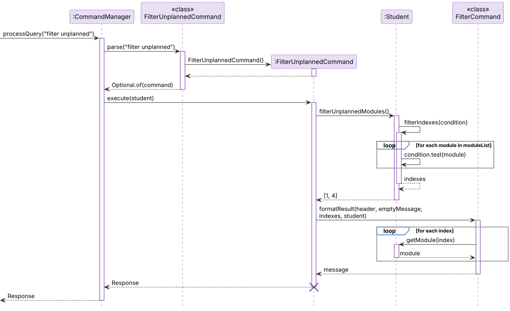
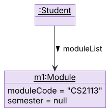
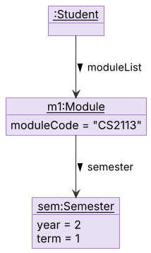

# Zhi Hou's Project Portfolio Page

## Project: ChatGPat

ChatGPat is a desktop application designed to help university students manage their academic modules, track their grades, and plan their academic performance. It allows students to organize their modules, calculate their Grade Point Average (GPA), and set academic goals.
The application is written in Java and uses a Command Line Interface (CLI) for user interactions.

Given below are my contributions to the project.

* **New Feature**: Added the ability to delete a module, `delete INDEX` ([#19](https://github.com/AY2627S1-CS2113-T11-2/tp/pull/19), [#25](https://github.com/AY2627S1-CS2113-T11-2/tp/pull/25)).
  * What it does: removes the module at the given position in the list shown by `list`.
  * Justification: users need a quick way to remove a module added by mistake.
  * Highlights: the index is validated before any data changes, and errors are shown as normal responses instead of crashing the program.

* **New Feature**: Added the ability to edit a module, `edit INDEX [m/MODULE_CODE] [c/CREDITS] [g/GRADE]` ([#20](https://github.com/AY2627S1-CS2113-T11-2/tp/pull/20), [#73](https://github.com/AY2627S1-CS2113-T11-2/tp/pull/73)).
  * What it does: changes any combination of a module's code, credits and grade.
  * Justification: users can fix a mistyped grade or credit without re-adding the module.
  * Highlights: the fields can be given in any combination, which made the parser more involved. Every field is checked before anything changes, including that new credits of an S/U-ed module still fit in the S/U quota, so a failed edit never leaves a module half-edited.

* **New Feature**: Added the ability to plan and unplan modules, `plan INDEX y/YEAR s/SEM` and `unplan INDEX` ([#38](https://github.com/AY2627S1-CS2113-T11-2/tp/pull/38), [#42](https://github.com/AY2627S1-CS2113-T11-2/tp/pull/42)).
  * What it does: assigns a module to a semester, or removes it from its semester again.
  * Justification: students plan their modules across four years of study.
  * Highlights: I added the self-validating `Semester` value type, and a module's semester is optional, so unplanned modules are handled throughout the app.

* **New Feature**: Added the ability to list unplanned modules, `filter unplanned` ([#50](https://github.com/AY2627S1-CS2113-T11-2/tp/pull/50)).
  * What it does: lists the modules not planned for any semester yet, without changing the list.
  * Justification: it shows at a glance which modules still need a semester.
  * Highlights: matching modules keep their **original** index from `list`, so the numbers work directly with other commands, and a predicate-based helper in `Student` lets other filters reuse it.

* **Code contributed**: [RepoSense link](https://nus-cs2113-ay2627-s1.github.io/tp-dashboard/?search=nathanng-boop&breakdown=true)

* **Project management**:
  * Published the [v2.0](https://github.com/AY2627S1-CS2113-T11-2/tp/releases/tag/v2.0) and [v2.1](https://github.com/AY2627S1-CS2113-T11-2/tp/releases/tag/v2.1) releases with their JAR files.
  * Led a final review of the code, UG and DG before submission, and fixed the issues found ([#67](https://github.com/AY2627S1-CS2113-T11-2/tp/pull/67), [#71](https://github.com/AY2627S1-CS2113-T11-2/tp/pull/71), [#72](https://github.com/AY2627S1-CS2113-T11-2/tp/pull/72), [#73](https://github.com/AY2627S1-CS2113-T11-2/tp/pull/73)).
  * Merged teammates' PRs (for example [#47](https://github.com/AY2627S1-CS2113-T11-2/tp/pull/47), [#51](https://github.com/AY2627S1-CS2113-T11-2/tp/pull/51), [#58](https://github.com/AY2627S1-CS2113-T11-2/tp/pull/58)) and resolved DG merge conflicts.

* **Enhancements to existing features**:
  * Fixed bugs found in the final review ([#67](https://github.com/AY2627S1-CS2113-T11-2/tp/pull/67)): malformed commands show their usage instead of crashing (via a shared `ParserUtil`), credits are limited to 1 to 40 MCs, logs go to a file, and the app exits cleanly when input ends.
  * Grew the test suite from 166 to 206 JUnit tests ([#67](https://github.com/AY2627S1-CS2113-T11-2/tp/pull/67), [#73](https://github.com/AY2627S1-CS2113-T11-2/tp/pull/73)) and improved code quality: coding-standard names, a loop instead of a long if-chain, less nesting and more assertions ([#73](https://github.com/AY2627S1-CS2113-T11-2/tp/pull/73)).
  * Updated the `help` command to list every command and its format ([#56](https://github.com/AY2627S1-CS2113-T11-2/tp/pull/56)).

* **Documentation**:
  * User Guide: `plan` ([#38](https://github.com/AY2627S1-CS2113-T11-2/tp/pull/38)), `unplan` ([#42](https://github.com/AY2627S1-CS2113-T11-2/tp/pull/42)), `filter unplanned` and the command summary ([#50](https://github.com/AY2627S1-CS2113-T11-2/tp/pull/50)), tables of contents ([#65](https://github.com/AY2627S1-CS2113-T11-2/tp/pull/65)), and the v2.1 update with real outputs, error messages, an FAQ and the home page ([#71](https://github.com/AY2627S1-CS2113-T11-2/tp/pull/71)).
  * Developer Guide:
    * Design section: Architecture overview and the UI, Logic, Model, Storage and Common components ([#59](https://github.com/AY2627S1-CS2113-T11-2/tp/pull/59), [#63](https://github.com/AY2627S1-CS2113-T11-2/tp/pull/63)).
    * Implementation sections for `delete`, `edit`, `plan`, `unplan` ([#39](https://github.com/AY2627S1-CS2113-T11-2/tp/pull/39)), `gpa` and `quota` ([#62](https://github.com/AY2627S1-CS2113-T11-2/tp/pull/62)), and a revamp of the whole `filter` section ([#50](https://github.com/AY2627S1-CS2113-T11-2/tp/pull/50)).
    * Product scope, User Stories, NFRs, Glossary and manual testing ([#57](https://github.com/AY2627S1-CS2113-T11-2/tp/pull/57)), and the v2.1 update of the whole guide ([#72](https://github.com/AY2627S1-CS2113-T11-2/tp/pull/72)).
    * UML diagrams (5 types): architecture and component class diagrams, plus class, sequence, object and activity diagrams for `delete`, `edit`, `plan`, `unplan`, `filter`, `gpa`, `quota` and storage.

* **Community**: reviewed PRs [#47](https://github.com/AY2627S1-CS2113-T11-2/tp/pull/47) and [#40](https://github.com/AY2627S1-CS2113-T11-2/tp/pull/40).

* **Tools**: set up the team's PlantUML workflow (shared `style.puml`, PNG exports), since GitHub Pages does not render Mermaid.

## Contributions to the Developer Guide (Extracts)

Given below are short extracts from my part of the Developer Guide. See the full guide for the other features.

### Filter unplanned feature

`filter unplanned` lists the modules that have no semester. `FilterUnplannedCommand` asks `Student` for the 1-based indexes of the modules whose semester is not set, then fetches each module with `Student#getModule(int)` so that the original numbering is kept. If every module is planned, it returns "All modules are planned." instead.

### Plan feature

`plan INDEX y/YEAR s/SEM` stores a `Semester` in the chosen module. The object diagrams show the state before and after `plan 1 y/2 s/1`.

